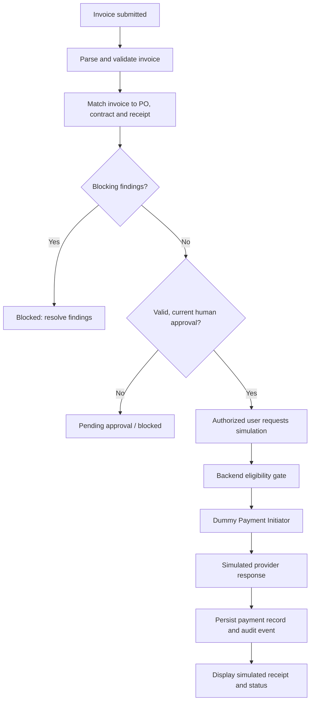

# WorkplaceOps AI — Dummy Payment Initiator Implementation Plan

**Project:** Singularity Squad — WorkplaceOps AI, Request-to-Payment Copilot  
**Purpose:** Add a realistic, demonstrable payment-initiation stage to the workflow while ensuring that no real funds can be transferred.  
**Status:** Recommended implementation specification; not yet implemented in the repository.

---

## 1. Objective

Build a **Dummy Payment Initiator** that simulates the interaction between an enterprise procurement system and a payment provider. It should accept only eligible, internally approved invoices, create a simulated payment instruction, and return a realistic provider-style response.

The feature should make the end-to-end demo feel like a real request-to-payment workflow without connecting to a bank, payment gateway, vendor banking system, or external payment API.

### Non-goals

- No real payment, bank transfer, or settlement.
- No collection or storage of real bank credentials, card details, or payment secrets.
- No external provider calls.
- No LLM-generated action that can bypass deterministic backend checks.
- No claim that a simulated payment has actually reached a vendor.

Every screen, API response, log entry, and receipt must identify the environment as **SIMULATION / NO MONEY TRANSFERRED**.

---

## 2. Proposed end-to-end flow

1. A user submits a procurement request.
2. Intake and policy evaluation run as they do today.
3. Vendor matching and PO drafting run as they do today.
4. The invoice is parsed and checked against the PO, rate card/contract, and relevant delivery or receipt evidence.
5. The backend checks that all required internal approvals are valid and current.
6. The authorized user explicitly requests a simulated payment.
7. The backend creates one simulated payment instruction using an idempotency key.
8. The simulator returns a provider-style reference and a simulated status.
9. The system records an immutable audit event and exposes the status in the UI.
10. The Critic may flag issues but must never override a block or create/execute a payment.



---

## 3. Architectural placement

Implement the simulator as a **backend service/tool**, not as an autonomous agent. The Manager/Orchestrator can expose the action to the UI, but the service itself must enforce eligibility independently of the LLM and UI.

Suggested package structure (adapt names to the repository's existing conventions):

```text
app/
  payments/
    __init__.py
    schemas.py          # Pydantic request/response models and enums
    eligibility.py      # Deterministic backend eligibility checks
    simulator.py        # Local-only simulated provider
    service.py          # Idempotency, persistence, orchestration
    repository.py       # Payment record persistence
    routes.py           # Authenticated API endpoints
    audit.py            # Payment-specific audit event helpers, if needed
tests/
  payments/
    test_schemas.py
    test_eligibility.py
    test_simulator.py
    test_service.py
    test_routes.py
    test_security.py
```

These are proposed paths, not assertions that the repository already contains them. Reuse the existing MongoDB, approval, policy, and audit abstractions rather than creating parallel systems.

### Responsibilities

| Component | Responsibility |
|---|---|
| `schemas.py` | Validate amount, currency, invoice/PO IDs, statuses, and response shape |
| `eligibility.py` | Re-check policy, invoice match, blockers, approval status, and authorization |
| `simulator.py` | Generate a fake provider response locally; no network access |
| `service.py` | Idempotency, state transitions, persistence, and audit integration |
| `repository.py` | Store and retrieve payment simulation records |
| `routes.py` | Authenticate caller, enforce role checks, expose endpoints |
| UI | Show eligibility, require explicit confirmation, display clearly marked simulated receipt |

---

## 4. API contract

Use the project's existing FastAPI conventions and versioned API prefix.

### Suggested endpoints

| Method | Endpoint | Purpose |
|---|---|---|
| `GET` | `/api/payments/simulation/eligibility/{invoice_id}` | Return eligibility and blocking reasons without creating a payment |
| `POST` | `/api/payments/simulation` | Request one simulated payment after confirmation |
| `GET` | `/api/payments/simulation/{payment_id}` | Read simulated payment details |
| `GET` | `/api/payments/simulation/{payment_id}/events` | Read status and audit history |
| `POST` | `/api/payments/simulation/{payment_id}/retry` | Retry only eligible transient simulator failures, using the same logical payment/idempotency key |

All routes must require authentication and appropriate role authorization. Do not rely on hidden UI controls as security.

### Example request

```json
{
  "invoice_id": "INV-DEMO-1001",
  "purchase_order_id": "PO-DEMO-204",
  "amount": "48500.00",
  "currency": "INR",
  "simulation_only": true,
  "idempotency_key": "demo-inv-1001-v1",
  "confirmed_by_user": true
}
```

Treat the IDs and amounts above as synthetic demo data only. The backend must retrieve the canonical invoice/PO amounts from persisted records and validate the supplied values; do not trust the client to decide the payable amount.

### Example response

```json
{
  "mode": "SIMULATION",
  "money_transferred": false,
  "payment_id": "psim_01JDEMO8Q2",
  "provider_reference": "PAY-SIM-A83F21",
  "invoice_id": "INV-DEMO-1001",
  "purchase_order_id": "PO-DEMO-204",
  "amount": "48500.00",
  "currency": "INR",
  "method": "SIMULATED_NEFT",
  "status": "accepted_by_simulator",
  "created_at": "2026-10-17T10:00:00Z",
  "message": "Simulation accepted. No money was transferred."
}
```

The example response is illustrative. Generate IDs and timestamps at runtime. Do not label the result `paid` or `settled` unless those are explicitly simulated states and the UI prominently labels them as simulated. Prefer `accepted_by_simulator` to avoid implying a real bank acceptance.

### Error response

Return structured, safe errors such as:

```json
{
  "error": "PAYMENT_NOT_ELIGIBLE",
  "message": "The invoice is not eligible for payment simulation.",
  "reasons": [
    "Invoice-to-PO match is incomplete",
    "Required approval is missing"
  ],
  "mode": "SIMULATION",
  "money_transferred": false
}
```

Do not expose secrets, internal stack traces, or sensitive vendor information in error responses.

---

## 5. Eligibility gate — required before every initiation

Implement this in deterministic backend code. Re-evaluate immediately before creating a payment record, not only when the UI loads the eligibility page.

A payment simulation is eligible only if all applicable conditions are true:

- [ ] Invoice exists and is in a valid state.
- [ ] Purchase order exists and is associated with the invoice.
- [ ] Invoice-to-PO matching succeeds within the configured tolerances.
- [ ] Required contract/rate-card and receipt/delivery checks pass.
- [ ] No unresolved hard policy block, duplicate-invoice flag, fraud/risk flag, or mandatory clarification remains.
- [ ] Required internal approval exists, is authorized, and is current.
- [ ] Approval covers the canonical invoice/PO, amount, and currency.
- [ ] No relevant policy version, invoice content, PO content, or approval has changed since approval; otherwise invalidate/re-run approval.
- [ ] The caller has the payment-simulation permission.
- [ ] The amount is positive, finite, and taken from canonical backend records.
- [ ] Currency is allow-listed for the demo, initially `INR`.
- [ ] `simulation_only` is exactly `true`.
- [ ] The simulator implementation is selected by server-side configuration and cannot be overridden by request data.
- [ ] A durable audit record can be written, or the system can safely persist the operation and audit event atomically/outbox-style.

If any required check fails, **do not create a payment instruction**. Return a structured block with reason codes. Do not let the Critic, a prompt, a client flag, or an agent tool call override this gate.

### Suggested reason codes

- `INVOICE_NOT_FOUND`
- `PO_NOT_FOUND`
- `INVOICE_PO_MISMATCH`
- `INVOICE_MATCH_FAILED`
- `DUPLICATE_INVOICE`
- `POLICY_BLOCK`
- `CLARIFICATION_REQUIRED`
- `APPROVAL_MISSING`
- `APPROVAL_STALE`
- `AMOUNT_MISMATCH`
- `CURRENCY_NOT_ALLOWED`
- `CALLER_NOT_AUTHORIZED`
- `SIMULATION_DISABLED`
- `AUDIT_UNAVAILABLE`

---

## 6. Simulation-only safeguards

These are acceptance-critical requirements.

1. **No provider integration:** the simulator must not import or call bank, UPI, NEFT, RTGS, card, or payment-gateway SDKs.
2. **No network calls:** simulator code generates responses locally and must not make HTTP requests.
3. **Server-controlled mode:** set a server-side flag such as `PAYMENT_MODE=simulation`; fail closed if unset or invalid.
4. **Hard-coded simulation marker:** the server always returns `mode="SIMULATION"` and `money_transferred=false`; never accept these fields from the client as authoritative.
5. **No secrets:** no bank keys, payment tokens, account numbers, or production credentials in `.env`, logs, fixtures, or test data.
6. **No real banking details:** use fictional vendors and synthetic invoice data. Mask any existing sensitive fields in UI and logs.
7. **Clear UI language:** every payment view and receipt shows `SIMULATED — NO MONEY TRANSFERRED`.
8. **No production switch:** do not include a hidden or undocumented flag that silently turns the simulator into a real payment provider.
9. **Role enforcement:** only authorized internal roles can request the simulation; approval and initiation should be separate permissions where practical.
10. **Fail closed:** if approvals, policy checks, persistence, or audit cannot be verified, do not initiate the simulation.
11. **Safe deployment defaults:** simulation disabled until explicitly enabled for a demo environment, or enabled only in a dedicated development/demo profile. Never infer demo mode from a client request.
12. **Read-only Critic:** the Critic can report findings but cannot initiate, retry, or mutate payment state.

A future real-payment integration would require a separate, explicitly reviewed project with provider sandbox testing, security review, authorization controls, reconciliation, operational monitoring, and financial/legal sign-off. It is outside this feature's scope.

---

## 7. State model

Use explicit transitions and reject illegal transitions.

```text
ELIGIBILITY_CHECKED
    ├── blocked checks ──> BLOCKED
    └── all checks pass ──> READY_FOR_SIMULATION
                               └── explicit user confirmation
                                   └──> SUBMITTED_TO_SIMULATOR
                                           ├──> ACCEPTED_BY_SIMULATOR
                                           ├──> PROCESSING_SIMULATED
                                           └──> FAILED_SIMULATED
```

Recommended terminal/derived statuses:

- `blocked`
- `ready_for_simulation`
- `submitted_to_simulator`
- `accepted_by_simulator`
- `processing_simulated`
- `settled_simulated` (optional, must remain clearly fictional)
- `failed_simulated`
- `cancelled_simulated` (only if cancellation semantics are implemented)

Do not represent simulated settlement as real settlement. Keep `money_transferred=false` invariant for every record and event.

---

## 8. Idempotency and concurrency

Repeated requests, browser retries, and concurrent calls must not create duplicate logical payment records.

- Require an idempotency key generated by the client or server.
- Scope the key to the invoice/payment intent and authenticated actor or tenant.
- Enforce a unique database index on the idempotency scope/key.
- Store a request fingerprint that includes the canonical invoice ID, PO ID, amount, and currency.
- If the same key and same request are repeated, return the existing record.
- If the same key is reused with a different fingerprint, return `409 IDEMPOTENCY_CONFLICT`.
- Use atomic insert/upsert or a transaction to handle simultaneous requests.
- A retry must not create a new logical payment intent; it should append a retry event to the existing record.
- Add tests for simultaneous requests and duplicate POSTs.

Do not use a process-local dictionary as the only idempotency store.

---

## 9. Persistence and audit trail

Reuse the project's existing MongoDB and audit abstractions.

### Suggested record fields

```json
{
  "payment_id": "psim_example",
  "mode": "SIMULATION",
  "money_transferred": false,
  "invoice_id": "INV-DEMO-1001",
  "purchase_order_id": "PO-DEMO-204",
  "amount": "48500.00",
  "currency": "INR",
  "method": "SIMULATED_NEFT",
  "status": "accepted_by_simulator",
  "idempotency_key_hash": "sha256:...",
  "request_fingerprint": "sha256:...",
  "approval_id": "approval-demo-12",
  "policy_set_version": "policy-set-demo-v3",
  "provider_reference": "PAY-SIM-A83F21",
  "created_by": "demo-user",
  "created_at": "2026-10-17T10:00:00Z",
  "updated_at": "2026-10-17T10:00:00Z",
  "events": []
}
```

Use decimal-safe money representation (for example, `Decimal` and a consistent MongoDB Decimal128/string serialization policy), never binary floating point for financial values.

### Audit events

Record events such as:

- `payment_simulation_eligibility_passed`
- `payment_simulation_blocked`
- `payment_simulation_requested`
- `payment_simulation_created`
- `payment_simulation_status_changed`
- `payment_simulation_retry_requested`
- `payment_simulation_failed`
- `payment_simulation_idempotent_replay`

Each event should include a timestamp, actor, entity references, correlation/trace ID, result, reason codes where relevant, and simulation marker. Never log secrets or unnecessary personal/vendor data.

### Audit/persistence consistency

Prefer one transaction where supported, or a durable outbox/reconciliation approach. If the payment record is written but audit fails, the system must not silently report success. Make the operation recoverable and observable. Add a reconciliation check for records missing expected audit events.

---

## 10. Demo simulator behavior

Keep outcomes deterministic and controllable in tests. Do not rely on random success/failure to validate the core workflow.

Suggested demo profiles:

- **Normal acceptance:** eligible request returns `accepted_by_simulator`.
- **Transient failure:** configured test fixture returns `failed_simulated` with `SIMULATED_PROVIDER_UNAVAILABLE`.
- **Policy block:** no payment record is created; return blocker reason codes.
- **Stale approval:** block until approval is refreshed.
- **Duplicate request:** return the original payment record.
- **Amount mismatch:** block with `AMOUNT_MISMATCH`.
- **Audit unavailable:** fail closed or persist a recoverable pending operation without claiming successful completion.

Failure injection should be available only in local/test/demo environments and never exposed as an unrestricted public endpoint.

---

## 11. UI / demo experience

Add a **Payments (Simulation)** section to the existing UI.

### Eligibility screen

Show:
- Invoice and PO references.
- Canonical invoice amount and currency.
- Invoice/PO match status.
- Policy blockers and unresolved clarifications.
- Approval status, approver, approval reference, and policy version.
- A clear eligible/not-eligible result.

### Confirmation step

Before creation, show:

> You are about to create a **simulated payment instruction** for ₹48,500.00. This is a demo only. No bank will be contacted and no money will be transferred.

Require an explicit user action. The server must still re-check eligibility after confirmation.

### Result screen / receipt

Display:
- `SIMULATED — NO MONEY TRANSFERRED` prominently.
- Payment ID and fake provider reference.
- Amount/currency and synthetic invoice/PO references.
- Simulator status and timestamp.
- A timeline of state changes and relevant audit events.
- A copy/download option only if it preserves the simulation disclaimer.

Do not use a green `Paid` badge. Use labels like `Accepted by simulator` or `Simulated processing`.

---

## 12. Agent/tool contract

Expose a narrow tool such as `create_simulated_payment` with a schema validated by Pydantic.

The tool should:
- Accept invoice ID, PO ID, and an idempotency key.
- Require an authenticated actor context injected by the backend, not supplied by the LLM.
- Require explicit confirmation recorded by the UI/backend.
- Call the deterministic payment service.
- Return the simulation marker and result.
- Never accept an arbitrary URL, provider name, network target, account number, or client-selected payment mode.

Only the Manager/Orchestrator should route a request to the tool after the invoice and approval workflow has completed. The tool itself remains guarded by backend eligibility checks. The LLM may recommend or explain; it must not be the authority for approval, amount, or eligibility.

The Critic toolset remains read-only.

---

## 13. Configuration

Suggested demo configuration:

```dotenv
PAYMENT_MODE=simulation
PAYMENT_SIMULATION_ENABLED=true
PAYMENT_ALLOWED_CURRENCIES=INR
PAYMENT_SIMULATOR_PROFILE=normal
```

Rules:
- Parse and validate configuration at startup.
- Reject unknown `PAYMENT_MODE` values.
- Do not provide a real-payment mode in this implementation.
- In production-like environments, default simulation to disabled unless an explicit deployment profile permits it.
- Never print credentials or sensitive environment variables to logs.

If the application has a central settings class, add these there rather than reading environment variables ad hoc across modules.

---

## 14. Test plan

### Unit tests

- [ ] Valid request and response schema.
- [ ] Reject non-positive, NaN, infinite, or malformed amounts.
- [ ] Reject unsupported currency.
- [ ] Always return `mode=SIMULATION` and `money_transferred=false`.
- [ ] No real provider/network code path exists.
- [ ] Block missing invoice/PO or mismatched IDs.
- [ ] Block failed three-way match, duplicate invoice, policy block, or mandatory clarification.
- [ ] Block missing, revoked, unauthorized, or stale approval.
- [ ] Block changed invoice/PO amount after approval.
- [ ] Block unauthorized actor.
- [ ] Block if simulation is disabled.
- [ ] Fail safely if audit/persistence is unavailable.
- [ ] Correct legal state transitions only.
- [ ] Idempotent replay returns the same payment ID.
- [ ] Same idempotency key with changed request returns conflict.

### Integration tests

- [ ] Eligible invoice + valid approval creates one simulated payment record.
- [ ] Ineligible invoice creates no payment instruction.
- [ ] Two concurrent initiation requests create one logical payment.
- [ ] Retrying a transient simulator failure does not create a second logical payment.
- [ ] Approval or policy version change invalidates the old eligibility decision.
- [ ] Audit event and payment record can be reconciled after injected failure.
- [ ] Critic cannot initiate or mutate payment state.
- [ ] UI shows the simulation disclaimer on eligibility, detail, and receipt views.
- [ ] API never calls external hosts during simulator tests.
- [ ] Existing approval, policy-rule, invoice, and procurement tests still pass.

### Security regression tests

- [ ] Client cannot set `money_transferred=true`.
- [ ] Client cannot change mode to a real provider.
- [ ] Client cannot override the canonical payable amount.
- [ ] LLM/tool input cannot bypass approval.
- [ ] Direct API calls are subject to the same authorization as the UI.
- [ ] Error responses do not leak stack traces or secrets.

---

## 15. Observability

Add structured logs and metrics, with simulation mode included:

- `payment_simulation_requests_total`
- `payment_simulation_blocked_total` by reason code
- `payment_simulation_failures_total`
- `payment_simulation_idempotent_replays_total`
- `payment_simulation_audit_reconciliation_failures_total`
- Time from eligibility check to simulated response

Include correlation IDs linking the intake ticket, invoice, PO, approval, and simulated payment. Avoid logging full invoices, sensitive supplier information, or secret values.

---

## 16. Implementation phases

### Phase A — Inspect and align

1. Review existing FastAPI route patterns, authentication, MongoDB repositories, audit APIs, invoice/PO models, approval records, and UI navigation.
2. Identify the canonical source of invoice amounts, approval validity, and policy-set version.
3. Reuse existing models and services; avoid duplicate policy/approval logic.
4. Write down exact eligibility invariants before implementation.

**Exit criteria:** an agreed map of existing interfaces and the proposed payment service's dependencies.

### Phase B — Core simulator and schemas

1. Add Pydantic request/response and state models.
2. Add the deterministic eligibility service.
3. Add a local-only simulator with deterministic profiles.
4. Add idempotency and persistence.
5. Add audit integration and failure handling.

**Exit criteria:** unit tests pass; no network/provider integration exists.

### Phase C — API and authorization

1. Add authenticated eligibility, create, detail, event, and retry routes.
2. Add role checks for simulation initiation and separate approval authority.
3. Re-check eligibility inside the create service.
4. Add idempotency conflict handling.
5. Add structured error responses.

**Exit criteria:** API integration and security tests pass.

### Phase D — UI integration

1. Add the Payments (Simulation) navigation item.
2. Add eligibility details and blocker reasons.
3. Add explicit confirmation with a no-transfer disclaimer.
4. Add simulated receipt and event timeline.
5. Ensure every status badge is simulation-specific.

**Exit criteria:** a reviewer can follow a full successful and blocked demo without mistaking simulation for real payment.

### Phase E — End-to-end validation

1. Run all existing tests and the new payment tests.
2. Run clean-startup and migration/bootstrap tests against a disposable database.
3. Test duplicate requests, concurrent requests, stale approvals, and audit failure.
4. Inspect API traffic and verify no external payment/network calls occur.
5. Capture demo evidence: eligibility, confirmation, receipt, blocked case, and audit timeline.
6. Update README and `Docs/flow.md` to state that payment initiation is simulated only.

**Exit criteria:** reproducible test report, passing regression suite, and explicit documented simulation boundary.

---

## 17. Acceptance criteria

The feature is complete only when all of the following are true:

- [ ] The workflow can demonstrate request → policy checks → vendor match → draft PO → invoice match → approval → simulated payment instruction → simulated receipt.
- [ ] An eligible, approved synthetic invoice creates exactly one simulated payment record.
- [ ] Any missing approval or blocking finding prevents creation.
- [ ] Repeated requests do not create duplicate logical payments.
- [ ] Every record and response clearly states `SIMULATION` and `money_transferred=false`.
- [ ] No external provider or banking network is contacted.
- [ ] All actions are authorized and auditable.
- [ ] Payment eligibility is enforced in backend code, independent of UI and LLM output.
- [ ] Existing tests continue to pass and new tests cover security, failure, and concurrency.
- [ ] Documentation accurately distinguishes simulated initiation from real payment.

---

## 18. Demo script

Use only synthetic records.

1. Open an invoice with a matching draft PO and complete internal approval.
2. Show the eligibility screen with no blocking findings.
3. Click **Simulate Payment** and confirm the no-transfer warning.
4. Show the fake provider reference and `Accepted by simulator` status.
5. Open the event timeline and show eligibility, request, creation, and result events.
6. Repeat the same request and demonstrate idempotency: the same payment record is returned.
7. Open an invoice with a missing approval or policy block and show that simulation is denied.
8. Show the receipt disclaimer and explain that the simulator never contacted a bank.

Suggested demo narration:

> “WorkplaceOps AI has completed the internal controls and is now demonstrating the payment-initiation integration boundary. This creates a provider-style simulated instruction and auditable result only. No bank or payment gateway is contacted, and no money is transferred.”

---

## 19. Risks and mitigations

| Risk | Mitigation |
|---|---|
| Demo is mistaken for real payment | Persistent simulation banner, response fields, and receipt disclaimer |
| UI is used to bypass approval | Re-check eligibility in backend service for every create/retry request |
| Duplicate initiation after retry | Unique idempotency key and database constraint |
| Approval becomes stale | Bind approval to invoice/PO/amount/currency and policy version |
| Audit record missing | Transaction or durable outbox plus reconciliation |
| LLM invents payment details | Canonical backend data only; strict schema; no arbitrary provider fields |
| Simulator accidentally gains real integration | No provider SDK, no network path, security tests and code review |
| Tests pass only with seeded state | Clean-database startup and bootstrap-disabled test scenarios |

---

## 20. Final recommendation

Implement the payment initiator as a **simulation-only backend service with a deterministic eligibility gate, durable idempotency, audit history, authenticated endpoints, and an explicit UI confirmation step**.

Do not implement real payment execution in this phase. Keep the service isolated so a future provider sandbox integration can be designed and reviewed separately without weakening the current approval controls.

**Implementation status:** this document is a recommended design/specification only. It does not mean any code has been changed, deployed, or verified in the repository.
