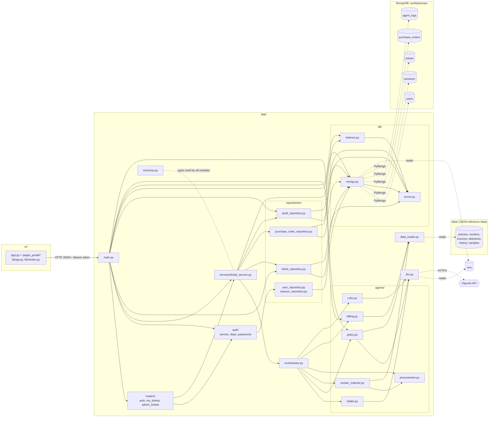
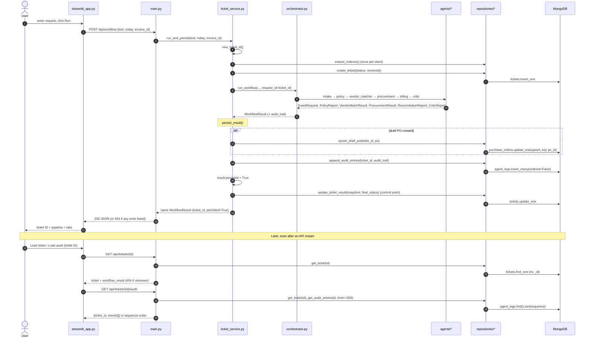
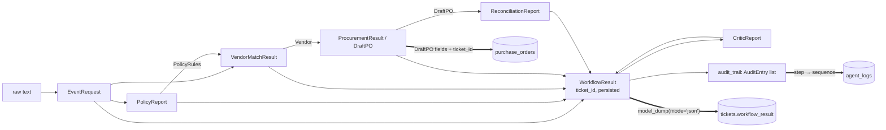
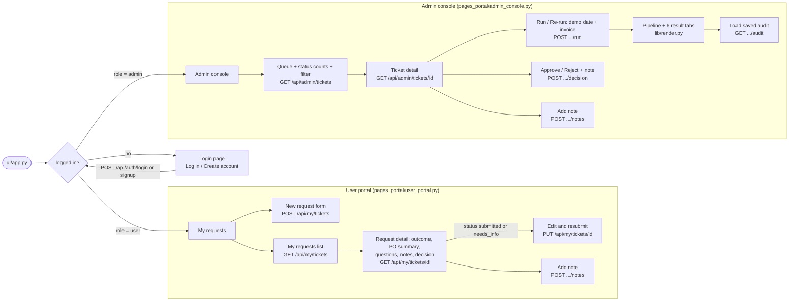
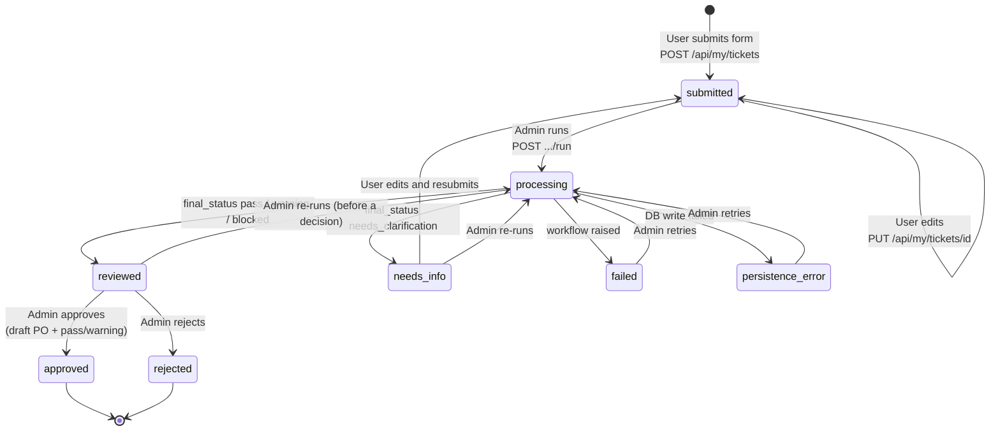
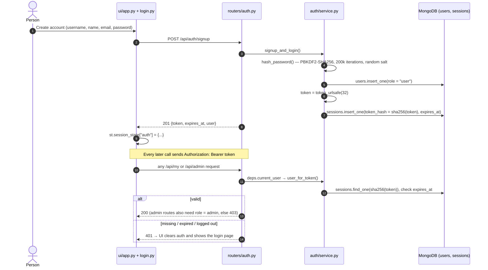
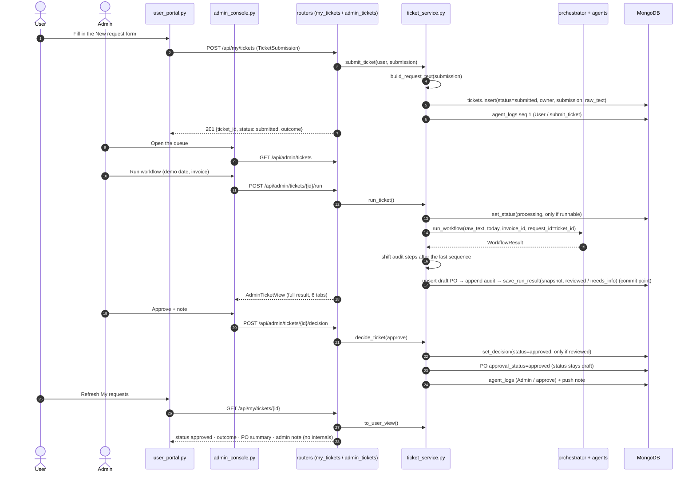

# WorkplaceOps AI — Execution Flow

This document covers:

- How to run the project.
- How folders and files depend on each other.
- How functions call each other during a workflow run.
- How data moves between agents.
- How each run is saved to MongoDB (Phase 1).
- The role-based portal: users submit tickets and the admin runs the workflow and decides (section 10).

All data is synthetic. The system creates a **draft PO only**. It never makes a purchase or payment. Saving a draft PO to the database does **not** approve or issue it.

---

## 1. How to run

```powershell
# 1. Install dependencies (use "python -m pip", or the venv's python)
python -m pip install -r requirements.txt

# 2. Configure .env (copy from .env.example; never commit .env)
#    API_KEY=sk-...                          LLM key (optional; without it the deterministic fallback runs)
#    MONGODB_URI=mongodb://localhost:27017/  local MongoDB or an Atlas SRV string
#    MONGODB_DATABASE=workplaceops
#    WORKPLACEOPS_PERSISTENCE=required       required = DB writes must succeed (else 503); disabled = no DB
#    WORKPLACEOPS_OFFLINE=1                  (optional) force no-LLM mode
#    ADMIN_USERNAME=admin                    admin account, created/updated at API startup
#    ADMIN_PASSWORD=<strong password>        (no admin account exists if unset; there is no default password)
#    SESSION_TTL_HOURS=8                     login session lifetime

# 3. Make sure MongoDB is running (Windows service "MongoDB", or Atlas)
mongosh --eval "db.adminCommand('ping')"

# 4. Terminal 1: start the backend API (indexes are created at startup)
python -m uvicorn app.main:app --port 8000 --reload
#    Swagger: http://127.0.0.1:8000/docs  ·  Health: http://127.0.0.1:8000/api/health

# 5. Terminal 2: start the UI (ui\app.py also works; streamlit_app.py is a shim that runs it)
python -m streamlit run ui\streamlit_app.py
#    UI: http://localhost:8501   (set WORKPLACEOPS_API if the API is not on 127.0.0.1:8000)
#    Log in as the admin from .env, or click "Create account" to register as a user.

# 6. Run tests. Most use in-memory mongomock. test_mongo_integration.py and
#    test_persistence_restart.py use local MongoDB in throwaway databases (dropped afterwards)
#    and skip themselves if MongoDB is not running.
python -m pytest -q

# 7. Pre-commit checks
git check-ignore -v .env      # must print the .env rule
git ls-files .env             # must print nothing
git diff --check
```

**Demo (two browser windows, or log out and back in):**

1. **User:** click **Create account**, then in **My requests → New request** fill in e.g. "Quarterly team lunch", Team lunch, Lunch, 2026-10-23, 100 attendees, ₹1,00,000, Bengaluru. Submit; the ticket shows as `submitted`.
2. **Admin:** log in with `ADMIN_USERNAME` / `ADMIN_PASSWORD`. The ticket appears in the **Admin console** queue.
3. Open the ticket, keep the demo date `2026-10-17`, pick an invoice (INV-5001 match, INV-5002 mismatch, INV-4987 duplicate), and click **Run workflow**. The six result tabs appear and the ticket becomes `reviewed`.
4. **Approve** (or **Reject**) with a note.
5. **User:** refresh **My requests**. The ticket shows "Approved — draft PO … for ₹76,125 recorded. No purchase has been made yet." with the admin's note.

To call the API directly, log in first; every ticket endpoint needs a bearer token:

```powershell
$login = @{ username = "admin"; password = "<ADMIN_PASSWORD>" } | ConvertTo-Json
$H = @{ Authorization = "Bearer " + (Invoke-RestMethod -Method Post http://127.0.0.1:8000/api/auth/login -Body $login -ContentType application/json).token }
Invoke-RestMethod http://127.0.0.1:8000/api/admin/tickets -Headers $H
Invoke-RestMethod -Method Post "http://127.0.0.1:8000/api/admin/tickets/<TICKET_ID>/run" -Headers $H -Body (@{ invoice_id = "INV-5001"; today = "2026-10-17" } | ConvertTo-Json) -ContentType application/json
```

**`Errno 10048` (port in use)** means another server is already running on that port. Find its PID with `Get-NetTCPConnection -LocalPort 8000 -State Listen` and run `Stop-Process -Id <PID>`, or use `--port 8001`.

---

## 2. Folder & file map

```text
AI_Hackathon_2.0/
├── .env / .env.example          # Secrets (git-ignored) / template (committed)
├── requirements.txt             # fastapi, pydantic, openai, streamlit, pymongo, mongomock (tests) ...
├── pytest.ini                   # registers the "real_mongo" marker
├── README.md / flow.md          # Docs
├── PHASE_1_MONGODB_PERSISTENCE.md  # Phase 1 spec
├── app/
│   ├── main.py                  # App wiring: lifespan (DB ping, indexes, admin seed), error handlers,
│   │                            #   public + admin-only legacy routes, includes the routers below
│   ├── routers/
│   │   ├── auth.py              # /api/auth/signup|login|logout|me
│   │   ├── my_tickets.py        # /api/my/tickets... (requester; own tickets only)
│   │   └── admin_tickets.py     # /api/admin/tickets... (admin: queue, run, decision, notes, audit)
│   ├── auth/
│   │   ├── passwords.py         # PBKDF2-SHA256 hashing (stdlib), constant-time verify
│   │   ├── service.py           # signup, login, logout, user_for_token, seed_admin_from_env
│   │   ├── deps.py              # FastAPI deps: current_user, require_user, require_admin
│   │   └── errors.py            # AuthError -> 401/403/409
│   ├── services/
│   │   ├── ticket_service.py    # submit/run/decide/notes/resubmit + views; run_and_persist (legacy)
│   │   └── errors.py            # TicketError -> 404/409/422
│   ├── portal_schemas.py        # Users, sessions, TicketSubmission, lifecycle statuses, user/admin views
│   ├── orchestrator.py          # Manager agent: runs the pipeline, builds WorkflowResult + audit trail (no DB)
│   ├── repositories/            # Data-access layer: the ONLY code that queries MongoDB
│   │   ├── ticket_repository.py         # tickets collection (lifecycle, owner, notes, decision)
│   │   ├── purchase_order_repository.py # purchase_orders collection (draft only; approval_status)
│   │   ├── audit_repository.py          # agent_logs collection
│   │   ├── user_repository.py           # users collection
│   │   └── session_repository.py        # sessions collection (hashed tokens, TTL)
│   ├── db/
│   │   ├── mongo.py             # one shared MongoClient, ping, db_status, persistence_mode
│   │   ├── indexes.py           # ensure_indexes() (idempotent)
│   │   └── errors.py            # PersistenceError (-> HTTP 503), AuditConflictError
│   ├── schemas.py               # Pydantic contracts (WorkflowResult now has ticket_id, persisted)
│   ├── llm.py                   # OpenAI wrapper; None on failure/offline -> fallback
│   ├── data_loader.py           # load_json() over data/ (cached)
│   └── agents/                  # Specialist agents: pure business logic, no DB access
│       ├── intake.py            # text -> EventRequest
│       ├── policy.py            # BM25 RAG over policies + rule checks
│       ├── vendor_matcher.py    # filter/rank vendors, re-plan
│       ├── procurement.py       # cost engine + draft PO (po_id derived from ticket id)
│       ├── billing.py           # 3-way invoice match + duplicate check
│       └── critic.py            # read-only final review
├── data/                        # Synthetic reference data (still JSON in Phase 1)
│   ├── policies/*.md, policy_rules.json, vendors.json
│   ├── invoices.json, deliveries.json, invoice_history.json
│   └── sample_requests.json
├── ui/                          # Frontend: HTTP only, never imports app/
│   ├── app.py                   # Entry point: health sidebar, login state, role-based st.navigation
│   ├── streamlit_app.py         # Shim, so "streamlit run ui\streamlit_app.py" still works
│   ├── lib/api.py               # HTTP helpers; adds the bearer token; a 401 logs out
│   ├── lib/render.py            # Shared renderers: pipeline, 6 result tabs, audit, INR formatting
│   └── pages_portal/
│       ├── login.py             # Log in / Create account
│       ├── user_portal.py       # New request form, My requests, outcome, notes, edit & resubmit
│       └── admin_console.py     # Queue + counts, ticket detail, run/re-run, approve/reject, notes, tabs
└── tests/
    ├── conftest.py              # sys.path, offline LLM, fresh mongomock client per test
    ├── test_intake.py, test_policy.py, test_vendor_procurement.py, test_billing.py, test_workflow.py
    ├── test_repositories.py     # repository behaviour on mongomock
    ├── test_api_persistence.py  # ticket endpoints, 404/422/503, disabled mode, invoice outcomes
    ├── test_persistence_failures.py # failure at each write stage, retry idempotency, no secret leaks
    ├── test_ui_tickets.py       # AppTest: admin console shows the stored persisted flag, 404/503
    ├── test_auth.py             # signup/login/logout, hashing, token expiry, admin seeding, 401/403
    ├── test_ticket_lifecycle.py # submit -> run -> approve/reject, re-run, needs_info, ownership, views
    ├── test_ui_portal.py        # AppTest: login, user submit/edit, admin run/approve, 401 handling
    ├── test_mongo_integration.py# real local MongoDB: indexes + duplicate-key behaviour
    └── test_persistence_restart.py # real MongoDB + 2 real uvicorn processes: survives API restart
```

Also at the repo root: `.gitattributes` (LF line endings). All text files are saved as UTF-8 **without a BOM**, so `.gitignore` and `.env.example` parse correctly.

### How files depend on each other (imports and I/O)



**Layering rules:**

- **UI → API over HTTP only.** The UI never imports `app/`. Streamlit `session_state` holds only the login token and cached display data; MongoDB is the source of truth.
- **Every ticket endpoint is authenticated.** `deps.py` resolves the bearer token. `require_admin` guards `/api/admin/*` and the legacy endpoints; `/api/my/*` is scoped to the owner.
- **Routes (`main.py`, `routers/`) validate input and map errors.** A missing or foreign ticket gives `404`, a malformed ID `422`, an illegal transition `409`, a missing or expired token `401`, the wrong role `403`, and a database failure `503`.
- **`services/ticket_service.py` owns the order of persistence steps.** It calls the orchestrator, then the repositories.
- **The orchestrator and agents have no database code**, so their business logic is unchanged.
- **Only `repositories/` queries MongoDB**, through the single shared client in `db/mongo.py`.
- **Reference data (vendors, policies, invoices) still comes from `data/*.json`.** Only run outputs go to MongoDB.

---

## 3. Execution flow: one workflow run

In the portal, a run starts when the admin clicks **Run workflow**, which calls `POST /api/admin/tickets/{id}/run` → `ticket_service.run_ticket()`. Section 10 covers that wrapper: lifecycle status, re-run audit offset and approval. The persistence core below (agents, then PO → audit → ticket commit point) is the same code path, `persist_result()`. The diagram shows the legacy admin-only `POST /api/workflow`, which creates the ticket and runs it in one call.


### Persistence steps (spec §9)

| # | Function | Collection | Notes |
|---|---|---|---|
| 1 | `ticket_service.new_ticket_id()` | – | `REQ-<yyyymmdd>-<8 hex>`, unique per submission |
| 2 | `_ensure_indexes_once()` → `ensure_indexes()` | all | idempotent; covers the case where startup ran while MongoDB was down |
| 3 | `create_ticket()` | `tickets` | `status="received"`, `workflow_result=None` |
| 4 | `run_workflow(..., request_id=ticket_id)` | – | agents run in memory exactly as before |
| 5 | `persist_result(ticket_id, result)` | – | runs steps 6–8; safe to retry for the same ticket |
| 6 | `upsert_draft_po()` | `purchase_orders` | only if a PO exists; upsert by `po_id`; rejects non-`draft` status |
| 7 | `append_audit_entries()` | `agent_logs` | `AuditEntry.step` → `sequence`. A retry with identical content is ignored; different content raises `AuditConflictError`. Existing events are never overwritten. |
| 8 | `update_ticket_result()` | `tickets` | **Commit point.** Saves the full JSON snapshot with `persisted=True` and `status=final_status`, only after steps 6–7 succeeded. |
| 9 | return | – | the same object that was stored: response and saved snapshot agree |

**Why the ticket update comes last:**

- The ticket snapshot is written after the PO and audit writes. So `workflow_result.persisted == true` in MongoDB always means every required write succeeded.
- The API response is the same object, so the two never disagree.
- The UI shows the stored flag as-is and never forces it to `true`.

**Failure policy (`WORKPLACEOPS_PERSISTENCE=required`):**

- A failed database write never returns success. The API returns `503` with a safe message, and the response has no `persisted` field.
- The server logs only the ticket ID and the error class: never the request text, the URI or credentials.
- Writes are **not atomic** across collections:

| Fails at | API | Ticket left as | Partial data that may exist |
|---|---|---|---|
| `create_ticket` | 503 | (no ticket) | nothing |
| workflow exception | error | `failed`, `workflow_result=null` | nothing else |
| `upsert_draft_po` | 503 | `persistence_error`, `workflow_result=null` | nothing else |
| `append_audit_entries` | 503 | `persistence_error`, `workflow_result=null` | draft PO (and possibly some audit events) |
| `update_ticket_result` | 503 | `persistence_error`, `workflow_result=null` | draft PO + all audit events |

- Partial data can be found by `ticket_id`.
- Calling `persist_result()` again for the same ticket completes it without duplicating the PO, the audit sequence or the ticket. This is covered by `test_retry_does_not_duplicate`.
- A transaction or outbox pattern is planned for a later reliability phase. **Nothing claims atomicity today.**

### Demo invoice binding

The synthetic invoices in `data/invoices.json` reference the placeholder `DRAFT-PO-1001`. Every ticket now gets a unique PO ID, so `billing.bind_demo_documents()` points the demo invoice and its delivery record at the current draft PO before reconciliation.

- It changes **only the PO number**. Vendor, rate, quantity, delivery and duplicate checks still apply.
- It works on copies; the seed data is never mutated.
- It records a `bind_demo_invoice` audit event.

---

## 4. Function call sequence



### Inside the workflow (agents, unchanged)

| # | Agent / function | Input | Output | LLM? | Reads |
|---|---|---|---|---|---|
| 1 | `intake.extract_request()` | text, today, request_id | `EventRequest`, missing fields, questions | extraction (regex wins on numbers) | – |
| 2 | `policy.evaluate()` → `retrieve()`, `get_clause()` | `EventRequest`, today | `PolicyReport` | summary only | `policies/*.md`, `policy_rules.json` |
| 3 | `vendor_matcher.match_vendors()` → `procurement.calculate_cost()` | request, rules | `VendorMatchResult` | no | `vendors.json` |
| 4 | `procurement.build_draft_po()` → `_po_id(request_id)` | request, vendor, rules | `ProcurementResult` | no | – |
| 5 | `billing.bind_demo_documents()`, `billing.reconcile()` | invoice, PO, delivery, history | `ReconciliationReport` | no | `invoices.json`, `deliveries.json`, `invoice_history.json` |
| 6 | `critic.review()` | `WorkflowResult` (read-only) | `CriticReport` | summary only | – |

---

## 5. Data contracts and MongoDB documents



| Collection | One document per | Key fields | Indexes |
|---|---|---|---|
| `tickets` | ticket | `ticket_id`, `status` (portal lifecycle: submitted / processing / reviewed / needs_info / approved / rejected / failed / persistence_error; legacy runs store the final status), `owner_username`, `owner_name`, `owner_email`, `submission`, `raw_text`, `workflow_result`, `notes[]`, `decision`, `run_count`, `last_run_by`, `last_run_at`, `error`, `created_at`, `updated_at`, `schema_version` | unique `ticket_id`; `updated_at` desc; `(owner_username, updated_at)`; `(status, updated_at)` |
| `purchase_orders` | draft PO | all `DraftPO` fields + `ticket_id`, `created_at`, `updated_at`, `schema_version`. `status` is always `draft`; `approval_status` (approved / rejected), `approved_by` and `approved_at` record the admin decision. | unique `po_id`; `ticket_id` |
| `agent_logs` | audit event | `ticket_id`, `sequence`, `agent` (agents, plus `User` / `Admin` for portal actions), `action`, `status`, `detail`, `evidence[]`, `llm_used`, `timestamp`, `schema_version` | unique `(ticket_id, sequence)`; `(ticket_id, timestamp)` |
| `users` | account | `username` (lowercase), `email` (lowercase), `name`, `role` (user / admin), `password_hash`, `salt`, `created_at`, `updated_at`, `schema_version` | unique `username`; unique `email` |
| `sessions` | login session | `token_hash` (SHA-256 of the token; the token itself is never stored), `username`, `role`, `created_at`, `expires_at` | unique `token_hash`; TTL on `expires_at` (expiry is also checked in code) |

- All timestamps are timezone-aware UTC.
- `_id` is never returned by the API.
- Only structured evidence is stored, never model chain-of-thought.

---

## 6. API endpoints

Auth: send `Authorization: Bearer <token>` (from login or signup).

**Public**

| Method | Path | Calls | Returns |
|---|---|---|---|
| GET | `/api/health` | `llm.llm_enabled()`, `db_status()` | `{status, llm_enabled, model, database: connected / unavailable / disabled, persistence}` |
| GET | `/api/samples` | `load_json()` | demo prompts |
| GET | `/api/invoices` | `billing.load_invoices()` | invoice summaries |
| POST | `/api/auth/signup` | `auth.service.signup_and_login()` | `201 {token, expires_at, user}`. Role is always `user`. `409` for a duplicate username or email; `422` for invalid input. |
| POST | `/api/auth/login` | `auth.service.login()` | `{token, expires_at, user}`; `401 "Invalid username or password."` (same message for an unknown user or wrong password) |

**Any logged-in user** (`routers/auth.py`, `routers/my_tickets.py`)

| Method | Path | Calls | Returns |
|---|---|---|---|
| POST | `/api/auth/logout` | `auth.service.logout()` | `204`; the token stops working |
| GET | `/api/auth/me` | `current_user` | `{username, name, email, role}` |
| POST | `/api/my/tickets` | `ticket_service.submit_ticket()` | `201 UserTicketView` with status `submitted`; no workflow is run |
| GET | `/api/my/tickets?limit=50` | `list_tickets_for_owner()` | `{tickets: [TicketListItem]}`, own tickets only |
| GET | `/api/my/tickets/{id}` | `to_user_view()` | `UserTicketView`: status, outcome text, submission, PO summary, clarification questions, notes, decision. **No agent internals.** `404` if not the owner. |
| PUT | `/api/my/tickets/{id}` | `user_update_ticket()` | edit and resubmit (status back to `submitted`); `409` unless status is `submitted` or `needs_info` |
| POST | `/api/my/tickets/{id}/notes` | `add_note()` | `UserTicketView` |

**Admin only** (`routers/admin_tickets.py`, plus the legacy routes in `main.py`). No token gives `401`; a user token gives `403`.

| Method | Path | Calls | Returns |
|---|---|---|---|
| GET | `/api/admin/tickets?status=&limit=100` | `list_tickets()`, `count_tickets_by_status()` | `{tickets: [TicketListItem], counts: {status: n}}` |
| GET | `/api/admin/tickets/{id}` | `to_admin_view()` | `AdminTicketView`: requester, submission, raw text, full `workflow_result`, notes, decision, run info |
| POST | `/api/admin/tickets/{id}/run` | `ticket_service.run_ticket()` | `AdminTicketView`; `409` if approved, rejected or already processing; `503` on DB failure |
| POST | `/api/admin/tickets/{id}/decision` | `ticket_service.decide_ticket()` | `AdminTicketView`; `409` if not `reviewed`, or for an approve with no draft PO or an outcome other than pass or warning |
| POST | `/api/admin/tickets/{id}/notes` | `add_note()` | `AdminTicketView` |
| GET | `/api/admin/tickets/{id}/audit?limit=500` | `get_audit_entries()` | `{ticket_id, events}` sorted by `sequence` |
| POST | `/api/workflow` | `ticket_service.run_and_persist()` | Legacy one-shot create and run: `WorkflowResult` with `ticket_id`, `persisted` |
| GET | `/api/tickets?limit=20` | `list_recent_tickets()` (limit 1–100) | `{tickets: [{ticket_id, created_at, updated_at, status, final_status}]}`, with no request text |
| GET | `/api/tickets/{ticket_id}` | `get_ticket()` | raw ticket document; `404` / `422` / `503` |
| GET | `/api/tickets/{ticket_id}/audit?limit=500` | `get_ticket()`, `get_audit_entries()` | `{ticket_id, events}`; `404` / `422` / `503` |
| POST | `/api/reconcile` | `bind_demo_documents()`, `billing.reconcile()` | `ReconciliationReport` (`404` if invoice unknown) |

Responses never contain `password_hash`, `salt`, `token_hash`, connection URIs or tracebacks.

**Startup and shutdown (`lifespan`):**

- On startup, `ping_database()`, `ensure_indexes()` and `seed_admin_from_env()` run.
  - `seed_admin_from_env()` creates or updates the admin from `ADMIN_USERNAME` / `ADMIN_PASSWORD`, re-hashing the password on each start, so changing `.env` takes effect after a restart.
  - It never promotes an existing normal user to admin.
- If MongoDB is down, the API still starts: `/api/health` reports `unavailable` and write requests return `503`.
- On shutdown, `close_client()` runs.

A startup failure is visible in two places:

- The logs show `MongoDB ping failed: ServerSelectionTimeoutError` and `MongoDB not reachable at startup ... will return 503`.
- `/api/health` shows `"database": "unavailable"`.

Neither includes the URI or credentials; this was verified with a URI containing a username and password.

**Configuration checklist:**

- Keep `WORKPLACEOPS_PERSISTENCE=required` for a persistence demo.
- Use `disabled` only for intentional non-persistent development; the UI then labels results "Not persisted".
- Give the database user permissions only on the application database.
- On Atlas, restrict network access and URL-encode special characters in the username and password.
- Never commit `.env`, database dumps or credentials. `.gitignore` covers `.env` and `.env.*`, with an exception for `!.env.example`.

---

## 7. Streamlit UI flow (role-based)



**UI behaviour:**

- The sidebar shows API, LLM and DB health, "Signed in as <name> (<role>)", and **Logout**. A disclaimer banner appears on every page.
- **Approve** is enabled only when the status is `reviewed`, a draft PO exists and the outcome is pass or warning. **Reject** is enabled when the status is `reviewed`. **Run** is disabled when the ticket is approved, rejected or processing. The backend enforces the same rules and returns `409`.
- The admin ticket banner shows the stored `workflow_result.persisted` flag as saved, plus the run count and who ran it last.
- Error messages:
  - `401` → "Session expired — please log in again." The user is logged out.
  - `404` → "Ticket not found."
  - `409` → the backend's message.
  - `503` → "Database unavailable…"
  - Backend down → a hint with the start command.
  - Tracebacks are never shown.
- The user portal never displays vendor evaluations, invoice checks, policy checks or the audit trail; the API doesn't send them.

---

## 8. Decision outcomes (demo date 2026-10-17)

| Scenario | What triggers it | Final status | Saved |
|---|---|---|---|
| happy_path + INV-5001 | VEN-001 unavailable → re-planned to VEN-002, ₹76,125, invoice matches | `pass` | ticket + draft PO + audit |
| happy_path + INV-5002 | Unit price 720 ≠ 700 (FIN-5.3); 100 billed vs 95 delivered (FIN-5.2) | `blocked` | ticket + draft PO + audit |
| happy_path + INV-4987 | Invoice already paid (FIN-5.4) | `blocked` | ticket + draft PO + audit |
| over_budget | ₹90,825 > ₹60,000 (EVT-3.3) | `blocked` | ticket + audit (**no PO**) |
| too_soon | < 5 business days (EVT-2.2); PO withheld | `blocked` | ticket + audit (no PO) |
| missing_info | date / attendees / budget missing | `needs_clarification` | ticket + audit (no PO) |
| MongoDB down | write fails | HTTP `503` | nothing claimed as saved |

---

## 9. Tests (`tests/`)

| File | Covers |
|---|---|
| `test_intake.py`, `test_policy.py` | Extraction, BM25 retrieval, policy checks |
| `test_vendor_procurement.py`, `test_billing.py` | Vendor eligibility, costing, approver tiers, reconciliation |
| `test_workflow.py` | Orchestrator end-to-end + original API endpoints |
| `test_repositories.py` | Serialization, `None` for unknown tickets, audit order, duplicate and conflict events, PO upsert idempotency, draft-only rule, error mapping, no `_id` |
| `test_api_persistence.py` | Unique ticket IDs, retrieval, audit order, 404/422/503, `persistence_error` marking, disabled mode, no PO when over budget, invoice outcomes unchanged with unique IDs |
| `test_persistence_failures.py` | Failure at create / PO / audit / ticket-update stages returns a safe 503 and leaves the ticket as `persistence_error` with no snapshot. Also: partial state can be diagnosed, a retry doesn't duplicate data, logs leak no credentials or request text, and the success snapshot equals the response. |
| `test_ui_tickets.py` | Streamlit AppTest (admin console): a loaded ticket shows the stored `persisted` value (true or false); friendly 404 and 503 messages; requests without the admin token get `401` |
| `test_auth.py` | Signup and auto-login, duplicate username/email `409` (case-insensitive), validation `422`, identical `401` for an unknown user or wrong password, missing/garbage/expired token `401`, logout revokes the token, admin seeding and re-seeding, no escalation of existing users, `role` in the signup body ignored, salted hashes, no secrets in responses, `require_admin` `403` |
| `test_ticket_lifecycle.py` | Submit (no run, no PO); ownership isolation (`404`); admin queue, counts and filter; run → reviewed with persisted snapshot and draft PO; re-run keeps one PO and audit sequences contiguous; approve (PO still `draft`) and reject; run after a decision `409`; approve when blocked `409`; needs_info → edit and resubmit → re-run; notes from both sides; the user view has no internals; concurrent-run guard; form → request text mapping (numbers in notes can't override the form) |
| `test_ui_portal.py` | Streamlit AppTest with a fake backend: login and signup per role, user submit payload, list and detail with no internals, needs_info edit (`PUT`), admin queue, run, tabs, approve/reject enablement, notes, `409` messages, `401` logs out, shim entry point |
| `test_mongo_integration.py` | Real local MongoDB: index names and uniqueness, duplicate-key behaviour (skipped if MongoDB is down) |
| `test_persistence_restart.py` | **Acceptance test.** Real MongoDB in a unique throwaway database, against real uvicorn process #1, then process #2. Submits a ticket, restarts, and checks the ticket, snapshot, draft PO and audit history are identical. Also checks that an over-budget ticket stores no PO. Skips if MongoDB is unavailable. |

- `conftest.py` gives each test a fresh in-memory `mongomock` client and forces offline LLM mode.
- Tests marked `real_mongo` use a real local MongoDB instead, in a uniquely named database that is dropped afterwards. They never touch the default `workplaceops` database.

### Phase 1 verification record (2026-10-17)

- `python -m pytest -q`: **86 passed**, including the real-MongoDB restart acceptance test.
- Manual live run with the LLM enabled, port 8010, throwaway database: all 6 scenarios returned the expected status. Each response and its stored snapshot both had `persisted=true`.
- After an API restart, all 6 tickets and their audit histories (sequences in order) reloaded. There were 3 draft POs, all `draft`, with no duplicate POs or audit sequences.
- In Streamlit against the restarted API, Load ticket and Load audit showed the saved result and 10 events, and an unknown ticket showed "Ticket not found."
- With a database URI containing a username and password, pointed at a dead port: health showed `unavailable`, workflow returned `503`, and neither the responses nor the logs contained the credentials.
- `.env` is ignored and untracked, there are no BOMs or garbled characters, and `git diff --check` is clean.

---

## 10. Role-based portal: users submit, the admin runs and decides

### 10.1 Ticket lifecycle (`tickets.status`)



**Lifecycle rules:**

- **`status` vs `final_status`:** `status` is the portal lifecycle that both roles see. The workflow's own verdict, `workflow_result.final_status`, is unchanged.
- **One run at a time:** `run_ticket()` claims the ticket with a conditional update to `processing`, and only if it is still runnable. A second concurrent run gets `409`.
- **Re-runs keep history:** each run's audit events continue after the last sequence, using an offset applied to copies of the audit entries. The unique `(ticket_id, sequence)` index holds and the full history is kept. The PO is upserted by `po_id`, so there is never more than one.
- **Approval is a recorded decision only:** the PO keeps `status: "draft"` and gets `approval_status: "approved"`. Nothing is issued, purchased or paid.
- **Every portal action is audited:** submit, resubmit, run, approve and reject are written to `agent_logs` with agent `User` or `Admin`.

### 10.2 Auth flow



The admin account is never created through the UI. It is seeded at startup from `ADMIN_USERNAME` and `ADMIN_PASSWORD` in `.env`.

### 10.3 End-to-end: user → admin → user



### 10.4 Turning the form into workflow input

The agents are unchanged. `build_request_text()` turns the structured form into the request text the intake agent already understands.

- **Structured values come first.** The parser takes the first match, so free text that comes later can't override them. Example:
  `Organize lunch for 100 employees on 2026-10-23. Keep the total under Rs 1,00,000. Use an approved vendor and follow the workplace event policy. Venue: at the Bengaluru office. Event: Team lunch — Quarterly team lunch. Additional notes: …`
- **Free text can't change the catering service.** In the title, location and notes, a meal word that the parser would rank above the chosen service is reworded. For example, "breakfast" becomes "morning meal" when the user picked dinner. The "Team lunch" category label becomes "Team meal" when another service is chosen.
- **The structured submission is stored on the ticket too**, so the admin can compare what the user entered (`submission`) with what the agent extracted (`workflow_result.request`).
- **Event categories are labels.** Costing still uses the catering service, because vendor data only covers lunch, breakfast, dinner and snacks. A request no vendor can serve is flagged by the existing checks (no eligible vendor → blocked) rather than faked.

### 10.5 Portal verification record (2026-10-17)

- `python -m pytest -q`: **149 passed**, including the auth, lifecycle, portal UI and real-MongoDB restart tests.
- **Live API run** (LLM enabled, throwaway database):
  - Legacy `/api/workflow` with no token: `401`. Admin login: `200`. Two user signups: `201`. A user calling a legacy route: `403`.
  - A user submitted a ticket: `submitted`. The other user got `404` on it and saw an empty list.
  - The admin ran it with INV-5001: `reviewed`, final status `pass`, reconciliation `match`, `persisted=true`. The form values were extracted exactly: lunch, 100 attendees, ₹1,00,000, 2026-10-23, Bengaluru.
  - A re-run gave run count 2. Approve gave `approved`, and a run after that `409`.
  - The user saw: "Approved — draft PO … for ₹76,125 recorded. No purchase has been made yet.", the PO summary (status `draft`, approval `approved`) and the admin note. The view had only the 10 allowed fields.
  - The audit had 22 events with contiguous sequences, from `submit_ticket` to `approve`.
  - A dinner request for 120 people on ₹60,000 was parsed as dinner and came back `blocked`. Approve gave `409`, reject gave `rejected`, and the user saw "Rejected by admin. Note: Over budget, please revise."
  - Editing a ticket while `reviewed` gave `409`; editing a `submitted` one gave `200`. After logout, the old token got `401`.
- **Real Streamlit pages against the live API:** a new user signed up and submitted through the form; the admin logged in, saw the status counts, loaded and ran the ticket (6 tabs) and approved it, after which Run was disabled. The user then saw the decision and note with no internals, and no page raised an exception.
- `streamlit run ui\streamlit_app.py` (the shim) serves the app; the health check returned `ok`.
