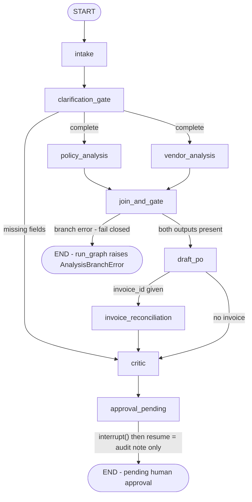

# LangGraph proof of concept (Stage 3 — experiment only)

An isolated re-implementation of the WorkplaceOps workflow (`app.orchestrator.run_workflow`) as a LangGraph
`StateGraph`, built to decide **with evidence** whether LangGraph should replace the hand-written orchestrator.
The main app never imports this package and `requirements.txt` does not contain LangGraph (both enforced by
`tests\test_langgraph_poc.py::test_main_app_is_isolated_from_experiment`). Deleting `experiments\` and
`requirements-langgraph.txt` removes the experiment completely.

## Install and run

```powershell
.\venv\Scripts\python.exe -m pip install -r requirements-langgraph.txt   # langgraph==1.2.16 (optional)
.\venv\Scripts\python.exe -m pytest -q tests\test_langgraph_poc.py       # skipped if langgraph is absent
$env:WORKPLACEOPS_OFFLINE="1"; $env:POLICY_RAG_ENABLED="0"; $env:POLICY_RULES_ENABLED="0"
.\venv\Scripts\python.exe -m experiments.langgraph_poc.graph --reps 30   # latency benchmark (JSON)
```

```python
from datetime import date
from experiments.langgraph_poc import run_graph, start, resume

r = run_graph("Organize lunch for 100 employees next Friday ...", date(2026, 10, 17), "INV-5001")
r.final_status, r.human_approval_required        # ('pass', True) - same WorkflowResult as run_workflow

p = start("Organize lunch ...", date(2026, 10, 17))  # pauses at approval_pending (interrupt)
p["interrupt"]                                       # {'final_status': ..., 'approver': ..., 'message': ...}
done = resume(p["thread_id"], "looks good")          # note recorded in audit; still pending human approval
```

## Graph



## Design

- **State** (`state.py`): `GraphInput` (text, today, invoice_id, request_id), `GraphOutput` (request,
  missing_fields, policy, vendors, procurement, reconciliation, critic, final_status, approver, human_note, audit,
  branch_errors) and internal keys (`rules`, `policy_blocked`). `audit` and `branch_errors` use an
  `operator.add` reducer; everything else has a single writer. The parallel branches write disjoint keys and do
  **not** write audit entries — `join_and_gate` audits policy then vendor, so audit order is deterministic.
- **Reuse**: nodes call the existing agents (`intake`, `policy`, `vendor_matcher`, `procurement`, `billing`) and
  `app.orchestrator._worst` / `_Audit` / `_finish` (Critic + final status + `human_approval_gate`), so the
  `WorkflowResult` and the audit trail (steps, agents, actions, statuses, details) are identical to `run_workflow`.
- **Clarification**: missing fields route straight to `critic` (the orchestrator also still runs Critic and the
  approval gate for `needs_clarification`), so the result is identical rather than a bare END.
- **Fail closed**: a branch exception is caught inside the branch node and recorded in `branch_errors`;
  `join_and_gate` also treats a missing output as an error and routes to END, so `draft_po`, Critic and approval
  never run. `run_graph` then raises `app.orchestrator.AnalysisBranchError(branch, cause)` (policy reported first)
  — the same contract as the orchestrator, so no partial result can be mistaken for success.
- **Human in the loop**: `approval_pending` calls `interrupt()` (MemorySaver checkpointer, per-run `thread_id`).
  `resume(thread_id, value)` stores the value as `extra["human_note"]` plus a `Human/human_note` audit entry; it
  never changes `final_status`, keeps `human_approval_required=True` and **cannot approve** — approval remains
  in the backend approvals service with its RBAC/SoD checks. Resuming a thread that is not paused raises.
- **Checkpoint deserialization** is allow-listed to the eight `app.schemas` models used in state
  (`new_checkpointer()`), avoiding LangGraph's "unregistered type" warning without enabling arbitrary types.
- Side-effect free: no DB writes, no network, no payment; `run_graph` returns at the pause like `run_workflow`.

## Measured evidence (2026-10-21, Windows, Python 3.11, offline, happy_path, 30 reps + 1 warm-up)

| Scenario | `run_workflow` (parallel) median / p95 | `run_graph` median / p95 | Delta (median) |
|---|---|---|---|
| Offline, no added latency | 1.63 ms / 2.44 ms | 19.08 ms / 21.54 ms | +17.5 ms (~11.7x) |
| 150 ms sleep in `policy.evaluate` and `match_vendors` | 152.31 ms / 152.60 ms | 168.69 ms / 178.87 ms | +16.4 ms (+10.8%) |

Overhead breakdown: `build_graph()` compile ≈ 9.0 ms median, `invoke` on a pre-built graph ≈ 10.9 ms median
(checkpointing every superstep). Both engines overlap the two 150 ms branches (≈152 ms, not ≈300 ms), so
LangGraph adds no parallelism the orchestrator does not already have.

Size / dependencies: `graph.py` 265 non-blank non-comment lines + `state.py` 39 lines, versus 153 for
`app\orchestrator.py` (which also contains the parallel `analyze` helper). `pip install langgraph` added
**18 distributions** not otherwise required by the app (`pip show` / metadata walk): langgraph, langgraph-checkpoint,
langgraph-prebuilt, langgraph-sdk, langchain-core, langchain-protocol, langsmith, jsonpatch, jsonpointer, orjson,
ormsgpack, pyyaml, requests-toolbelt, tenacity, uuid-utils, xxhash, zstandard, distro.

## Evaluation against spec §6

| Criterion | Result | Evidence |
|---|---|---|
| Correctness | ✅ Same | Parity tests for happy_path, over_budget, missing_info, too_soon, happy_path + INV-5001 / INV-5002 / INV-4987 / unknown invoice, and no eligible vendor: vendor id, PO total, final_status, reconciliation, missing_fields, approver, full audit (step, agent, action, status, detail) all equal |
| Parallelism | ✅ Yes (no gain) | `test_analysis_branches_overlap` (2-party barrier, 2 threads). 150 ms sleep run ≈168 ms, not ≈300 ms — but the orchestrator already achieves ≈152 ms |
| State clarity | ➖ Mixed | Typed input/output/internal state and declared edges are explicit; but correct audit ordering required moving audit writes out of the branches and a reducer, which is less obvious than the linear orchestrator |
| Error handling | ✅ Fail closed | `test_branch_failure_fails_closed_and_stops_draft_po[policy/vendor]`: `build_draft_po` call count 0, graph ends at join with `branch_errors`, `run_graph` raises `AnalysisBranchError` |
| Auditability | ✅ Same | Audit trail identical to the orchestrator; checkpoints add per-superstep state history (in memory only) |
| Resumability | ✅ Works | `test_pause_resume_...`: after resume, intake / policy / vendor / PO call counters unchanged (1 each); second resume rejected |
| Human-in-the-loop | ✅ Cannot bypass | `interrupt()` pause; resume with "APPROVED - please pay now" leaves `final_status` and `human_approval_required=True` unchanged, only adds a note. Real approval is already enforced by the backend approvals service |
| Testing | ✅ Practical | 14 tests, ~2.3 s, offline; nodes are plain functions and testable directly |
| Performance | ⚠️ Slower | +16–17 ms per run (+10.8% with realistic 150 ms branches, ~12x offline) |
| Maintenance | ❌ Not justified | +18 transitive packages (LangChain core, LangSmith client, msgpack/zstd/orjson native wheels), ~2x the orchestration code, a second mental model (supersteps, reducers, Command/interrupt), and a fast-moving 1.x API (deserialization allow-list already needed) |

## Recommendation: **NO-GO** (keep the current orchestrator; keep this PoC as reference)

LangGraph reproduced the workflow exactly, fails closed, and makes pause/resume genuinely easy — but per §6
"Adoption decision" it must *materially* improve state handling, routing, recovery or pause/resume. Today it does
not: the workflow is a short, linear, single-request pipeline; the orchestrator already runs the two analyses in
parallel with deterministic audit ordering; and the only real human pause (approval) is a durable, multi-day,
RBAC-protected backend process stored in MongoDB, which an in-memory `MemorySaver` thread does not replace (a
production LangGraph pause would need a persistent checkpointer plus its own security review). In exchange it adds
18 dependencies, ~16 ms per run, and more code.

Revisit (re-run this PoC's tests and benchmark) if the workflow gains long-running multi-step human tasks inside a
single run, retries/recovery of individual expensive LLM nodes, or dynamic multi-agent routing that would otherwise
be hand-coded.
