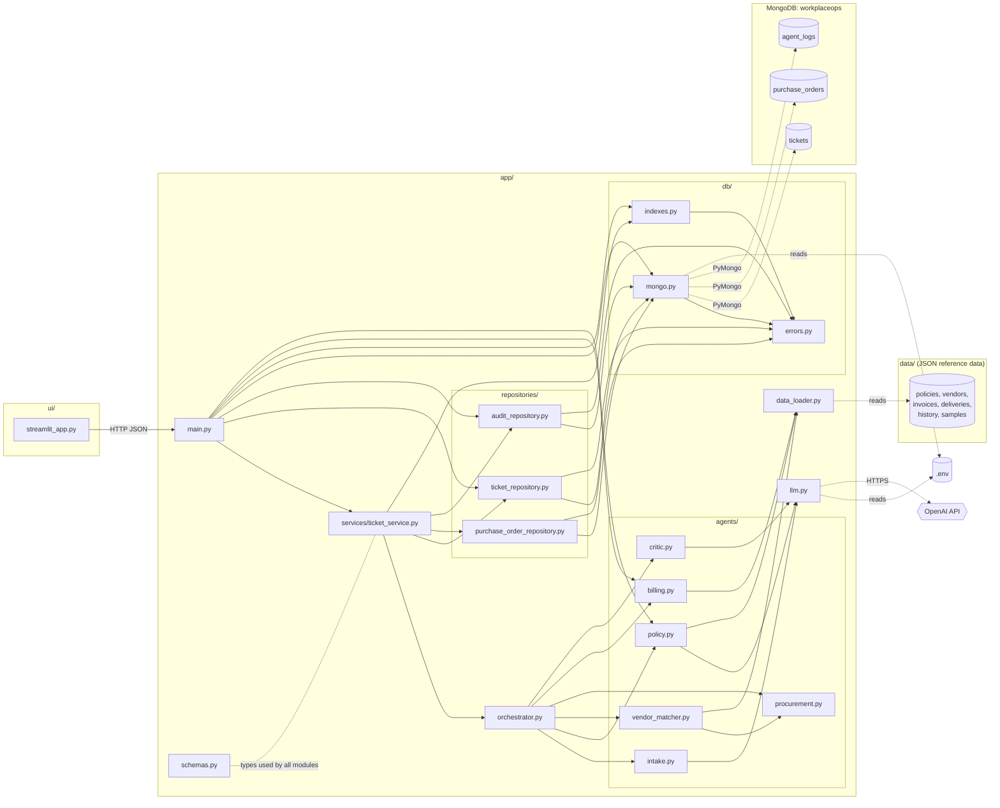
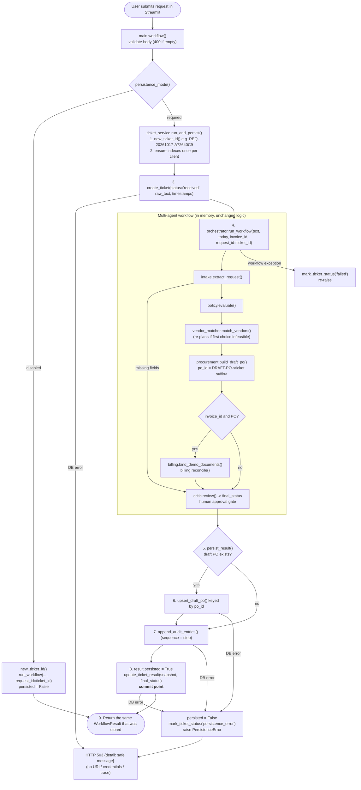
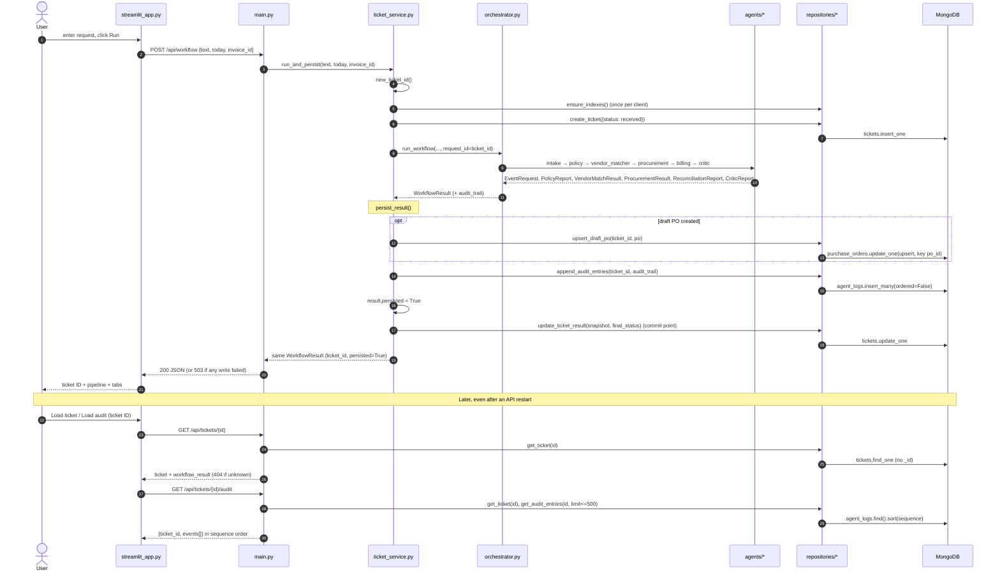
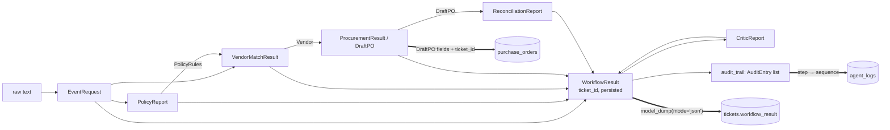
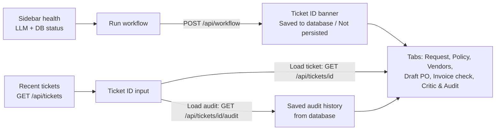

# WorkplaceOps AI — Execution Flow

This document covers:

- How to run the project.
- How folders and files depend on each other.
- How functions call each other during a workflow run.
- How data moves between agents.
- How each run is saved to MongoDB (Phase 1).

All data is synthetic. The system creates a **draft PO only**. It never makes a purchase or payment. Saving a draft PO to the database does **not** approve or issue it.

---

## 1. How to run

```powershell
# 1. Install dependencies (use "python -m pip", or the venv's python)
python -m pip install -r requirements.txt

# 2. Configure .env (copy from .env.example; never commit .env)
#    API_KEY=sk-...                          LLM key (optional; without it the deterministic fallback runs)
#    MONGODB_URI=mongodb://localhost:27017/  local MongoDB or an Atlas SRV string
#    MONGODB_DATABASE=workplaceops
#    WORKPLACEOPS_PERSISTENCE=required       required = DB writes must succeed (else 503); disabled = no DB
#    WORKPLACEOPS_OFFLINE=1                  (optional) force no-LLM mode

# 3. Make sure MongoDB is running (Windows service "MongoDB", or Atlas)
mongosh --eval "db.adminCommand('ping')"

# 4. Terminal 1: start the backend API (indexes are created at startup)
python -m uvicorn app.main:app --port 8000 --reload
#    Swagger: http://127.0.0.1:8000/docs  ·  Health: http://127.0.0.1:8000/api/health

# 5. Terminal 2: start the UI
python -m streamlit run ui\streamlit_app.py
#    UI: http://localhost:8501   (set WORKPLACEOPS_API if the API is not on 127.0.0.1:8000)

# 6. Run tests. Most use in-memory mongomock. test_mongo_integration.py and
#    test_persistence_restart.py use local MongoDB in throwaway databases (dropped afterwards)
#    and skip themselves if MongoDB is not running.
python -m pytest -q

# 7. Pre-commit checks
git check-ignore -v .env      # must print the .env rule
git ls-files .env             # must print nothing
git diff --check
```

**Demo:**

1. Set the sidebar demo date to `2026-10-17`.
2. Pick the `happy_path` sample and an invoice: INV-5001 (match), INV-5002 (mismatch), or INV-4987 (duplicate).
3. Click **Run workflow**. The response shows a ticket ID such as `REQ-20261017-A72640C9`.
4. Restart the API, paste the ticket ID into **Saved tickets → Load ticket / Load audit**, and the same result and audit history come back from MongoDB.

To call the API directly:

```powershell
$b = @{ text = "Organize lunch for 100 employees next Friday. Keep the total under Rs 1,00,000, use an approved vendor."; today = "2026-10-17"; invoice_id = "INV-5001" } | ConvertTo-Json
$r = Invoke-RestMethod -Method Post http://127.0.0.1:8000/api/workflow -Body $b -ContentType application/json
$r.ticket_id
Invoke-RestMethod "http://127.0.0.1:8000/api/tickets/$($r.ticket_id)"
Invoke-RestMethod "http://127.0.0.1:8000/api/tickets/$($r.ticket_id)/audit"
```

**`Errno 10048` (port in use)** means another server is already running on that port. Find its PID with `Get-NetTCPConnection -LocalPort 8000 -State Listen` and run `Stop-Process -Id <PID>`, or use `--port 8001`.

---

## 2. Folder & file map

```text
AI_Hackathon_2.0/
├── .env / .env.example          # Secrets (git-ignored) / template (committed)
├── requirements.txt             # fastapi, pydantic, openai, streamlit, pymongo, mongomock (tests) ...
├── pytest.ini                   # registers the "real_mongo" marker
├── README.md / flow.md          # Docs
├── PHASE_1_MONGODB_PERSISTENCE.md  # Phase 1 spec
├── app/
│   ├── main.py                  # HTTP layer: routes, lifespan (DB ping + indexes), 503 mapping
│   ├── services/
│   │   └── ticket_service.py    # new_ticket_id(), run_and_persist(): workflow + persistence steps
│   ├── orchestrator.py          # Manager agent: runs the pipeline, builds WorkflowResult + audit trail (no DB)
│   ├── repositories/            # Data-access layer: the ONLY code that queries MongoDB
│   │   ├── ticket_repository.py         # tickets collection
│   │   ├── purchase_order_repository.py # purchase_orders collection (draft only)
│   │   └── audit_repository.py          # agent_logs collection
│   ├── db/
│   │   ├── mongo.py             # one shared MongoClient, ping, db_status, persistence_mode
│   │   ├── indexes.py           # ensure_indexes() (idempotent)
│   │   └── errors.py            # PersistenceError (-> HTTP 503), AuditConflictError
│   ├── schemas.py               # Pydantic contracts (WorkflowResult now has ticket_id, persisted)
│   ├── llm.py                   # OpenAI wrapper; None on failure/offline -> fallback
│   ├── data_loader.py           # load_json() over data/ (cached)
│   └── agents/                  # Specialist agents: pure business logic, no DB access
│       ├── intake.py            # text -> EventRequest
│       ├── policy.py            # BM25 RAG over policies + rule checks
│       ├── vendor_matcher.py    # filter/rank vendors, re-plan
│       ├── procurement.py       # cost engine + draft PO (po_id derived from ticket id)
│       ├── billing.py           # 3-way invoice match + duplicate check
│       └── critic.py            # read-only final review
├── data/                        # Synthetic reference data (still JSON in Phase 1)
│   ├── policies/*.md, policy_rules.json, vendors.json
│   ├── invoices.json, deliveries.json, invoice_history.json
│   └── sample_requests.json
├── ui/streamlit_app.py          # Frontend: HTTP only; run workflow, load ticket, load audit
└── tests/
    ├── conftest.py              # sys.path, offline LLM, fresh mongomock client per test
    ├── test_intake.py, test_policy.py, test_vendor_procurement.py, test_billing.py, test_workflow.py
    ├── test_repositories.py     # repository behaviour on mongomock
    ├── test_api_persistence.py  # ticket endpoints, 404/422/503, disabled mode, invoice outcomes
    ├── test_persistence_failures.py # failure at each write stage, retry idempotency, no secret leaks
    ├── test_ui_tickets.py       # Streamlit AppTest: load ticket shows the stored persisted flag, 404/503
    ├── test_mongo_integration.py# real local MongoDB: indexes + duplicate-key behaviour
    └── test_persistence_restart.py # real MongoDB + 2 real uvicorn processes: survives API restart
```

Also at the repo root: `.gitattributes` (LF line endings). All text files are saved as UTF-8 **without a BOM**, so `.gitignore` and `.env.example` parse correctly.

### How files depend on each other (imports and I/O)



**Layering rules:**

- **UI → API over HTTP only.** The UI never imports `app/`. Streamlit `session_state` only caches display data; MongoDB is the source of truth.
- **Routes (`main.py`) validate input and map errors.** A missing ticket gives `404`, a malformed ID `422`, and a database failure `503`.
- **`services/ticket_service.py` owns the order of persistence steps.** It calls the orchestrator, then the repositories.
- **The orchestrator and agents have no database code**, so their business logic is unchanged.
- **Only `repositories/` queries MongoDB**, through the single shared client in `db/mongo.py`.
- **Reference data (vendors, policies, invoices) still comes from `data/*.json`.** Only run outputs go to MongoDB.

---

## 3. Execution flow: `POST /api/workflow`



### Persistence steps (spec §9)

| # | Function | Collection | Notes |
|---|---|---|---|
| 1 | `ticket_service.new_ticket_id()` | – | `REQ-<yyyymmdd>-<8 hex>`, unique per submission |
| 2 | `_ensure_indexes_once()` → `ensure_indexes()` | all | idempotent; covers the case where startup ran while MongoDB was down |
| 3 | `create_ticket()` | `tickets` | `status="received"`, `workflow_result=None` |
| 4 | `run_workflow(..., request_id=ticket_id)` | – | agents run in memory exactly as before |
| 5 | `persist_result(ticket_id, result)` | – | runs steps 6–8; safe to retry for the same ticket |
| 6 | `upsert_draft_po()` | `purchase_orders` | only if a PO exists; upsert by `po_id`; rejects non-`draft` status |
| 7 | `append_audit_entries()` | `agent_logs` | `AuditEntry.step` → `sequence`. A retry with identical content is ignored; different content raises `AuditConflictError`. Existing events are never overwritten. |
| 8 | `update_ticket_result()` | `tickets` | **Commit point.** Saves the full JSON snapshot with `persisted=True` and `status=final_status`, only after steps 6–7 succeeded. |
| 9 | return | – | the same object that was stored: response and saved snapshot agree |

**Why the ticket update comes last:**

- The ticket snapshot is written after the PO and audit writes. So `workflow_result.persisted == true` in MongoDB always means every required write succeeded.
- The API response is the same object, so the two never disagree.
- The UI shows the stored flag as-is and never forces it to `true`.

**Failure policy (`WORKPLACEOPS_PERSISTENCE=required`):**

- A failed database write never returns success. The API returns `503` with a safe message, and the response has no `persisted` field.
- The server logs only the ticket ID and the error class: never the request text, the URI or credentials.
- Writes are **not atomic** across collections:

| Fails at | API | Ticket left as | Partial data that may exist |
|---|---|---|---|
| `create_ticket` | 503 | (no ticket) | nothing |
| workflow exception | error | `failed`, `workflow_result=null` | nothing else |
| `upsert_draft_po` | 503 | `persistence_error`, `workflow_result=null` | nothing else |
| `append_audit_entries` | 503 | `persistence_error`, `workflow_result=null` | draft PO (and possibly some audit events) |
| `update_ticket_result` | 503 | `persistence_error`, `workflow_result=null` | draft PO + all audit events |

- Partial data can be found by `ticket_id`.
- Calling `persist_result()` again for the same ticket completes it without duplicating the PO, the audit sequence or the ticket. This is covered by `test_retry_does_not_duplicate`.
- A transaction or outbox pattern is planned for a later reliability phase. **Nothing claims atomicity today.**

### Demo invoice binding

The synthetic invoices in `data/invoices.json` reference the placeholder `DRAFT-PO-1001`. Every ticket now gets a unique PO ID, so `billing.bind_demo_documents()` points the demo invoice and its delivery record at the current draft PO before reconciliation.

- It changes **only the PO number**. Vendor, rate, quantity, delivery and duplicate checks still apply.
- It works on copies; the seed data is never mutated.
- It records a `bind_demo_invoice` audit event.

---

## 4. Function call sequence



### Inside the workflow (agents, unchanged)

| # | Agent / function | Input | Output | LLM? | Reads |
|---|---|---|---|---|---|
| 1 | `intake.extract_request()` | text, today, request_id | `EventRequest`, missing fields, questions | extraction (regex wins on numbers) | – |
| 2 | `policy.evaluate()` → `retrieve()`, `get_clause()` | `EventRequest`, today | `PolicyReport` | summary only | `policies/*.md`, `policy_rules.json` |
| 3 | `vendor_matcher.match_vendors()` → `procurement.calculate_cost()` | request, rules | `VendorMatchResult` | no | `vendors.json` |
| 4 | `procurement.build_draft_po()` → `_po_id(request_id)` | request, vendor, rules | `ProcurementResult` | no | – |
| 5 | `billing.bind_demo_documents()`, `billing.reconcile()` | invoice, PO, delivery, history | `ReconciliationReport` | no | `invoices.json`, `deliveries.json`, `invoice_history.json` |
| 6 | `critic.review()` | `WorkflowResult` (read-only) | `CriticReport` | summary only | – |

---

## 5. Data contracts and MongoDB documents



| Collection | One document per | Key fields | Indexes |
|---|---|---|---|
| `tickets` | workflow run | `ticket_id`, `status` (received / pass / warning / blocked / needs_clarification / failed / persistence_error), `raw_text`, `workflow_result`, `created_at`, `updated_at`, `schema_version` | unique `ticket_id`; `updated_at` desc |
| `purchase_orders` | draft PO | all `DraftPO` fields + `ticket_id`, `created_at`, `updated_at`, `schema_version`; `status` is always `draft` | unique `po_id`; `ticket_id` |
| `agent_logs` | audit event | `ticket_id`, `sequence`, `agent`, `action`, `status`, `detail`, `evidence[]`, `llm_used`, `timestamp`, `schema_version` | unique `(ticket_id, sequence)`; `(ticket_id, timestamp)` |

- All timestamps are timezone-aware UTC.
- `_id` is never returned by the API.
- Only structured evidence is stored, never model chain-of-thought.

---

## 6. API endpoints (`app/main.py`)

| Method | Path | Calls | Returns |
|---|---|---|---|
| GET | `/api/health` | `llm.llm_enabled()`, `db_status()` | `{status, llm_enabled, model, database: connected / unavailable / disabled, persistence}` |
| GET | `/api/samples` | `load_json()` | demo prompts |
| GET | `/api/invoices` | `billing.load_invoices()` | invoice summaries |
| POST | `/api/workflow` | `ticket_service.run_and_persist()` | `WorkflowResult` with `ticket_id`, `persisted`; `503` on DB failure |
| GET | `/api/tickets?limit=20` | `list_recent_tickets()` (limit 1–100) | `{tickets: [{ticket_id, created_at, updated_at, status, final_status}]}`. Request text is deliberately excluded; the full text comes only from the single-ticket endpoint. |
| GET | `/api/tickets/{ticket_id}` | `get_ticket()` | ticket + `workflow_result`; `404` / `422` / `503` |
| GET | `/api/tickets/{ticket_id}/audit?limit=500` | `get_ticket()`, `get_audit_entries()` (limit 1–500) | `{ticket_id, events}` sorted by `sequence`; `404` / `422` / `503` |
| POST | `/api/reconcile` | `bind_demo_documents()`, `billing.reconcile()` | `ReconciliationReport` (`404` if invoice unknown) |

**Startup and shutdown (`lifespan`):**

- On startup, `ping_database()` and `ensure_indexes()` run. If MongoDB is down, the API still starts: `/api/health` reports `unavailable` and write requests return `503`.
- On shutdown, `close_client()` runs.

A startup failure is visible in two places:

- The logs show `MongoDB ping failed: ServerSelectionTimeoutError` and `MongoDB not reachable at startup ... will return 503`.
- `/api/health` shows `"database": "unavailable"`.

Neither includes the URI or credentials; this was verified with a URI containing a username and password.

**Configuration checklist:**

- Keep `WORKPLACEOPS_PERSISTENCE=required` for a persistence demo.
- Use `disabled` only for intentional non-persistent development; the UI then labels results "Not persisted".
- Give the database user permissions only on the application database.
- On Atlas, restrict network access and URL-encode special characters in the username and password.
- Never commit `.env`, database dumps or credentials. `.gitignore` covers `.env` and `.env.*`, with an exception for `!.env.example`.

---

## 7. Streamlit UI flow



The UI shows a clear message for each error: `404` ("Ticket not found"), `422` ("Invalid ticket ID format"), `503` (the backend's message), and a backend-down hint if the API can't be reached. It never shows a traceback.

**Load ticket** shows the stored `workflow_result.persisted` value exactly as saved. The banner reads "Loaded from database" with the ticket status. The recent-tickets dropdown shows only the ticket ID and status, never the request text.

---

## 8. Decision outcomes (demo date 2026-10-17)

| Scenario | What triggers it | Final status | Saved |
|---|---|---|---|
| happy_path + INV-5001 | VEN-001 unavailable → re-planned to VEN-002, ₹76,125, invoice matches | `pass` | ticket + draft PO + audit |
| happy_path + INV-5002 | Unit price 720 ≠ 700 (FIN-5.3); 100 billed vs 95 delivered (FIN-5.2) | `blocked` | ticket + draft PO + audit |
| happy_path + INV-4987 | Invoice already paid (FIN-5.4) | `blocked` | ticket + draft PO + audit |
| over_budget | ₹90,825 > ₹60,000 (EVT-3.3) | `blocked` | ticket + audit (**no PO**) |
| too_soon | < 5 business days (EVT-2.2); PO withheld | `blocked` | ticket + audit (no PO) |
| missing_info | date / attendees / budget missing | `needs_clarification` | ticket + audit (no PO) |
| MongoDB down | write fails | HTTP `503` | nothing claimed as saved |

---

## 9. Tests (`tests/`)

| File | Covers |
|---|---|
| `test_intake.py`, `test_policy.py` | Extraction, BM25 retrieval, policy checks |
| `test_vendor_procurement.py`, `test_billing.py` | Vendor eligibility, costing, approver tiers, reconciliation |
| `test_workflow.py` | Orchestrator end-to-end + original API endpoints |
| `test_repositories.py` | Serialization, `None` for unknown tickets, audit order, duplicate and conflict events, PO upsert idempotency, draft-only rule, error mapping, no `_id` |
| `test_api_persistence.py` | Unique ticket IDs, retrieval, audit order, 404/422/503, `persistence_error` marking, disabled mode, no PO when over budget, invoice outcomes unchanged with unique IDs |
| `test_persistence_failures.py` | Failure at create / PO / audit / ticket-update stages returns a safe 503 and leaves the ticket as `persistence_error` with no snapshot. Also: partial state can be diagnosed, a retry doesn't duplicate data, logs leak no credentials or request text, and the success snapshot equals the response. |
| `test_ui_tickets.py` | Streamlit AppTest: a loaded ticket shows the stored `persisted` value (true or false); 404 and 503 messages; recent tickets work without request text |
| `test_mongo_integration.py` | Real local MongoDB: index names and uniqueness, duplicate-key behaviour (skipped if MongoDB is down) |
| `test_persistence_restart.py` | **Acceptance test.** Real MongoDB in a unique throwaway database, against real uvicorn process #1, then process #2. Submits a ticket, restarts, and checks the ticket, snapshot, draft PO and audit history are identical. Also checks that an over-budget ticket stores no PO. Skips if MongoDB is unavailable. |

- `conftest.py` gives each test a fresh in-memory `mongomock` client and forces offline LLM mode.
- Tests marked `real_mongo` use a real local MongoDB instead, in a uniquely named database that is dropped afterwards. They never touch the default `workplaceops` database.

### Phase 1 verification record (2026-10-17)

- `python -m pytest -q`: **86 passed**, including the real-MongoDB restart acceptance test.
- Manual live run with the LLM enabled, port 8010, throwaway database: all 6 scenarios returned the expected status. Each response and its stored snapshot both had `persisted=true`.
- After an API restart, all 6 tickets and their audit histories (sequences in order) reloaded. There were 3 draft POs, all `draft`, with no duplicate POs or audit sequences.
- In Streamlit against the restarted API, Load ticket and Load audit showed the saved result and 10 events, and an unknown ticket showed "Ticket not found."
- With a database URI containing a username and password, pointed at a dead port: health showed `unavailable`, workflow returned `503`, and neither the responses nor the logs contained the credentials.
- `.env` is ignored and untracked, there are no BOMs or garbled characters, and `git diff --check` is clean.
