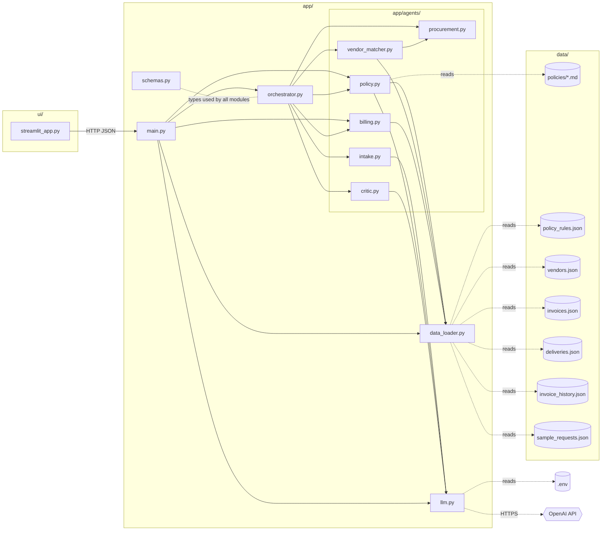
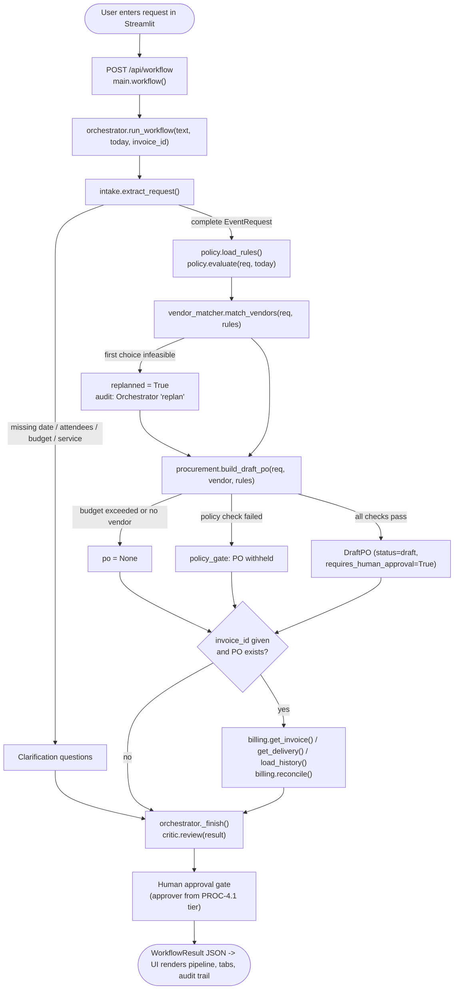
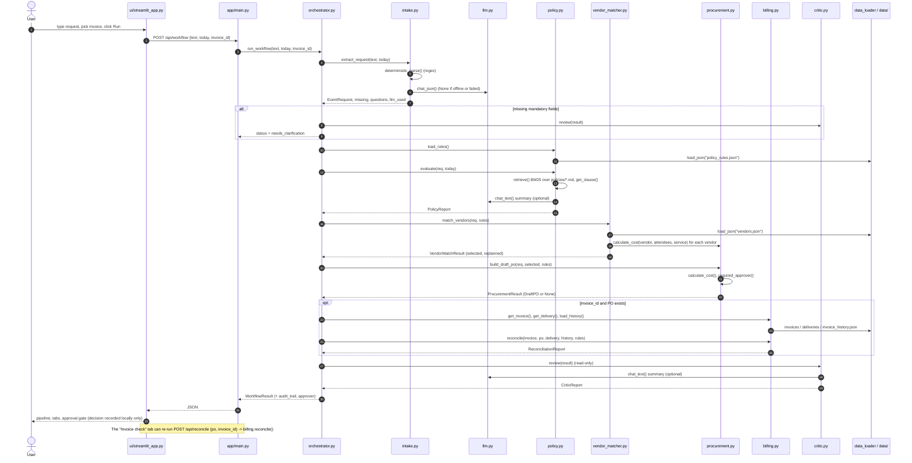
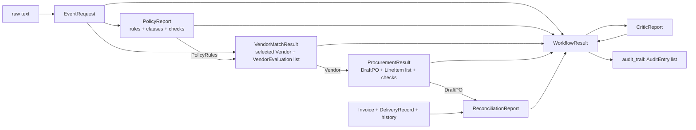

# WorkplaceOps AI — Execution Flow

This document shows four things:

- How the project runs.
- How the files and folders depend on each other.
- How the functions call each other during one workflow run.
- How data moves between the agents.

All data is synthetic. The system creates a **draft PO only**. It never makes a purchase or a payment.

---

## 1. How to run

```powershell
# 1. Install dependencies (use "python -m pip", not bare "pip")
python -m pip install -r requirements.txt

# 2. (Optional) configure the LLM in .env. Without a key, the deterministic fallback is used.
#    API_KEY=sk-...            or OPENAI_API_KEY=sk-...
#    OPENAI_MODEL=gpt-4o-mini  (optional)
#    OPENAI_BASE_URL=...       (optional, OpenAI-compatible / Azure endpoint)
#    WORKPLACEOPS_OFFLINE=1    (optional, force no-LLM mode)

# 3. Terminal 1: start the backend API
python -m uvicorn app.main:app --port 8000 --reload
#    Swagger docs: http://127.0.0.1:8000/docs

# 4. Terminal 2: start the UI
python -m streamlit run ui\streamlit_app.py
#    UI: http://localhost:8501   (set WORKPLACEOPS_API if the API is not on 127.0.0.1:8000)

# 5. Run tests (offline, no network)
python -m pytest -q
```

**Demo:**

1. In the sidebar, set the demo date to `2026-10-17`.
2. Pick the `happy_path` sample and an invoice: INV-5001 (match), INV-5002 (mismatch), or INV-4987 (duplicate).
3. Click **Run workflow**.

You can also call the API directly, without the UI:

```powershell
$b = @{ text = "Organize lunch for 100 employees next Friday. Keep the total under Rs 1,00,000, use an approved vendor."; today = "2026-10-17"; invoice_id = "INV-5002" } | ConvertTo-Json
Invoke-RestMethod -Method Post http://127.0.0.1:8000/api/workflow -Body $b -ContentType application/json
```

---

## 2. Folder & file map

```text
AI_Hackathon_2.0/
├── .env                         # API key (git-ignored), read by app/llm.py
├── requirements.txt             # Python dependencies
├── README.md / flow.md          # Docs
├── app/                         # Backend (FastAPI + agents)
│   ├── main.py                  # HTTP layer: REST endpoints
│   ├── orchestrator.py          # Manager agent: runs the pipeline, writes the audit trail
│   ├── schemas.py               # Pydantic data contracts shared by every module
│   ├── llm.py                   # OpenAI wrapper; returns None on failure or offline -> fallback
│   ├── data_loader.py           # load_json() over data/ (cached)
│   └── agents/                  # One module per specialist agent
│       ├── intake.py            # Intake & Triage: text -> EventRequest
│       ├── policy.py            # Policy Advisor: BM25 RAG over policies + rule checks
│       ├── vendor_matcher.py    # Planner & Vendor Matcher: filter/rank vendors, re-plan
│       ├── procurement.py       # Procurement: cost engine + draft PO + approver tier
│       ├── billing.py           # Billing Guardian: 3-way invoice match + duplicate check
│       └── critic.py            # Critic: read-only final review -> pass/warning/blocked
├── data/                        # Synthetic data (read-only at runtime)
│   ├── policies/*.md            # Policy clauses (## EVT-3.1 ..., ## FIN-5.4 ...)
│   ├── policy_rules.json        # Machine-readable thresholds + clause references
│   ├── vendors.json             # Vendors, rates, capacity, availability
│   ├── invoices.json            # Sample invoices (match / mismatch / duplicate)
│   ├── deliveries.json          # Signed delivery records
│   ├── invoice_history.json     # Previously paid invoices (duplicate detection)
│   └── sample_requests.json     # Demo prompts
├── ui/
│   └── streamlit_app.py         # Frontend: calls the API over HTTP only
└── tests/                       # pytest suites (conftest.py adds the repo root to sys.path)
```

### How files depend on each other (imports and I/O)



**Rules of the layering:**

- **The UI only talks to the API over HTTP.** It never imports `app/`.
- **`main.py` is a thin HTTP layer.** Business logic lives in `orchestrator.py` and `agents/`.
- **Agents never call each other through the orchestrator.** The one exception: `vendor_matcher.py` reuses `procurement.calculate_cost()` so that cost estimates come from a single formula.
- **Only `intake`, `policy` and `critic` use the LLM**, and only for language tasks. Every number and every pass/fail decision comes from plain Python.

---

## 3. Execution flow (one `/api/workflow` call)



### Step-by-step

| # | Agent / function | Input | Output | LLM? | Data files |
|---|---|---|---|---|---|
| 1 | `main.workflow()` | `WorkflowIn{text, today, invoice_id}` | calls orchestrator | – | – |
| 2 | `intake.extract_request()` → `deterministic_parse()` + `_llm_parse()` | raw text, today | `EventRequest`, missing fields, questions | yes (extraction; the regex parser wins on numbers) | – |
| 3 | `policy.evaluate()` → `retrieve()` (BM25), `get_clause()`, `business_days_between()`, `_summary()` | `EventRequest`, today | `PolicyReport` (checks + cited clauses) | summary only | `policies/*.md`, `policy_rules.json` |
| 4 | `vendor_matcher.match_vendors()` → `_evaluate()` → `procurement.calculate_cost()` | `EventRequest`, `PolicyRules` | `VendorMatchResult` (selected, evaluations, replanned) | no | `vendors.json` |
| 5 | `procurement.build_draft_po()` → `calculate_cost()`, `required_approver()`, `_po_id()` | request, vendor, rules | `ProcurementResult` (`DraftPO` or None + checks) | no | – |
| 6 | `billing.reconcile()` | `Invoice`, `DraftPO`, `DeliveryRecord`, history, rules | `ReconciliationReport` (match / mismatch / duplicate) | no | `invoices.json`, `deliveries.json`, `invoice_history.json` |
| 7 | `critic.review()` | full `WorkflowResult` (read-only) | `CriticReport` (pass / warning / blocked / needs_clarification) | summary only | – |
| 8 | `orchestrator._finish()` | result + audit | final status, approver, `audit_trail` | – | – |

**Audit trail:** every step calls `_Audit.log(agent, action, status, detail, evidence, llm_used)`. Each call produces one `AuditEntry`, and the UI shows these in the "Critic & Audit" tab.

---

## 4. Function call sequence



---

## 5. Data contracts passed between agents (`app/schemas.py`)



**Shared building blocks:**

- `CheckResult{name, status: pass|warn|fail|uncertain, detail, evidence[]}`
- `Evidence{source, detail}`. The source says where a fact came from: `policy:EVT-3.1`, `data:vendors.json#VEN-002`, or `calc`.

---

## 6. API endpoints (`app/main.py`)

| Method | Path | Calls | Returns |
|---|---|---|---|
| GET | `/api/health` | `llm.llm_enabled()`, `llm.model_name()` | `{status, llm_enabled, model}` |
| GET | `/api/samples` | `load_json("sample_requests.json")` | `{name: text}` |
| GET | `/api/invoices` | `billing.load_invoices()` | invoice summaries |
| POST | `/api/workflow` | `orchestrator.run_workflow()` | `WorkflowResult` |
| POST | `/api/reconcile` | `billing.reconcile()` with `policy.load_rules()` | `ReconciliationReport` (404 if invoice unknown) |

---

## 7. Decision outcomes (demo date 2026-10-17)

| Scenario | What triggers it | Final status |
|---|---|---|
| happy_path + INV-5001 | Preferred VEN-001 unavailable → re-planned to VEN-002, ₹76,125, invoice matches | `pass` |
| happy_path + INV-5002 | Unit price 720 ≠ 700 (FIN-5.3); 100 billed vs 95 delivered (FIN-5.2) | `blocked` |
| happy_path + INV-4987 | Invoice already paid (FIN-5.4) | `blocked` |
| over_budget | ₹90,825 > ₹60,000 (EVT-3.3); no PO | `blocked` |
| too_soon | < 5 business days lead time (EVT-2.2); PO withheld | `blocked` |
| missing_info | date / attendees / budget missing | `needs_clarification` |

---

## 8. Tests (`tests/`)

| File | Covers |
|---|---|
| `test_intake.py` | Request extraction for all samples, date and budget formats |
| `test_policy.py` | BM25 retrieval, business days, policy checks |
| `test_vendor_procurement.py` | Eligibility, re-planning, cost maths, budget, approver tiers |
| `test_billing.py` | Match / mismatch / duplicate reconciliation |
| `test_workflow.py` | End-to-end orchestrator and API endpoints (FastAPI TestClient) |
